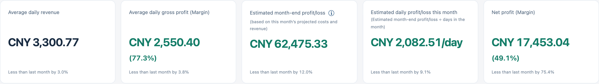

# 更新日志

**[← 返回中文 README](README.md)** · [English CHANGELOG](CHANGELOG.md)

## 版本目录

- [2026 Nov 10 V1.0.2](#2026-nov-10-v102) — 盈亏预测、费用分析与现金对账
- [2026 Nov 07 V1.0.1](#2026-nov-07-v101) — 修复账目录入、库存计价、现金余额与数据同步问题
- [2026 Oct 30 V1.0.0](#2026-oct-30-v100) — 首个归档版本

## 2026 Nov 10 V1.0.2

### 经营仪表盘与月度报表

**修改月度经营概览，由四张卡片调整为五张。** V1.0.1 显示营业收入、总成本、净利润和到店客人数。新版首页不再单列总成本和到店客人数。下表按首页顺序列出五项指标，每张卡片都与上月同一指标比较。

| 仪表盘指标（从左到右） | 相比 V1.0.1 的改动 | 本月计算方法 |
| --- | --- | --- |
| 日均收入 | **修改原卡片**，由整月营业收入改为日均收入。完整月报原已列出日均收入。 | 从本月 1 日到昨日的营业收入，除以这段期间的自然天数。 |
| 日均毛利润（毛利率） | **首页新增**，原已列入完整月报。 | 截至昨日的毛利润除以同一期间的自然天数，同时列出该期间的毛利率。 |
| 预计月底盈亏 | **首页新增**，原已列入完整月报，本版同时修改了预计成本的算法。 | 全月预计收入减去预计成本。第二行显示 **(根据 本月预计成本 和 本月预计收入 计算)**。 |
| 预计 本月每日盈亏 | **新增指标**，将预计月底盈亏折算为每日金额。 | 用尚未舍入的预计月底盈亏除以本月自然天数，以元/天显示。第二行显示 **(预计月底盈亏 ➗ 本月天数)**。 |
| 净利润（净利率） | **修改原卡片**，由第三张移至第五张。净利率现与金额一同显示，卡片下方改列环比。 | 截至今天的实际收入减去已录入的费用，其中包括已保存的整月固定支出。净利率为实际净利润除以实际收入。 |

两个月均有可比数据时，卡片显示环比百分比。数值相同显示 0.0%。上月为零、本月有变动时，卡片会说明无法计算百分比。缺少可比数据时也会提示。预计每日盈亏的环比按两个月各自的自然天数计算。完整月报仍单列实际日均净利润，当月用截至今天的实际净利润除以截至昨日已过的自然天数。

**修改月报的盈亏平衡提示。** 月报采用本版更新后的预测值，并简化了栏目名称。预计亏损且毛利率为正时，此项列出达到盈亏平衡所需增加的日均收入。

### 月底盈亏预测

**修改预计成本的计算方法。** 旧版从预计收入中扣除上月总成本。新版的仪表盘和完整月报分别估算固定支出、食材成本和其他成本。本月截至昨日的日均收入乘以本月自然天数，得到预计收入。再扣除三项预计成本，即为预计月底盈亏。

| 预计成本 | 计算方法 |
| --- | --- |
| 固定支出 | 比较上月实际固定支出与本月已保存的固定支出，取较高金额。本月尚未保存固定支出时，沿用上月金额。 |
| 食材成本（含佐料） | 比较上月与本月的日均食材成本，取较高值乘以本月自然天数。 |
| 其他成本 | 两个月分别用总成本减去食材成本（含佐料）及固定支出，算出各自的日均其他成本，取较高值乘以本月自然天数。 |

今天的采购或支出保存后，预计成本就可能发生变化。今天的收入从明天起计入预测。上月的日均成本按整月自然天数计算，本月按截至昨日已过的自然天数计算。没有录账的日期也计入天数。

本月截至昨日须至少有一笔日常经营记录，上月须至少有一笔日账或一份已保存的月度成本记录，才能计算本月预计盈亏。已记录的零值可以参与计算。月初第一天或记录不足时，显示横线。

**修改已结束月份的盈亏显示。** 下月 1 日当地时间零时起，已结束月份的月底盈亏显示实际净利润，每日盈亏显示实际净利润除以该月天数。此后补录或更正该月账目，两项金额都会更新。

**新增预测明细。** 仪表盘与完整月报均可点开预计月底盈亏旁的 **ⓘ**，查看两个月的各项成本及实际采用的数值。说明末尾依次列出预计日均总成本、预计总成本和预计收入，日均总成本按整月自然天数分摊。已结束月份显示对应的实际成本和收入。保存或同步账本后，系统保留所选月份并刷新说明，“更多统计”的高级视图也会同步更新。

### 图表与费用分析

- **修改“本月趋势”的默认指标**，打开时显示收入。**“各星期平均”新增独立的指标选择器**，原先只显示净利润，现在也默认显示收入。两张图均可选择收入、毛利润、净利润或食材成本（含佐料）。计算星期平均值时，只计入该星期几有经营记录的日期。
- **修改开销构成环图的配色，修复手机端居中问题。** 各成本类别采用不同颜色，图例与相应扇区同色。手机端的总成本金额与货币单位在圆环内居中显示。
- **“更多统计”新增经营、费用和客流摘要。** 经营分析统计盈利天数，费用分析列出金额最高的费用类别以及月度固定支出与逐笔付款的差额，客流分析标出客人最多的营业日。
- **新增折线图与柱状图切换**，可查看平均值、取值范围和记录数。**修复手机及桌面端的横轴标签重叠问题。** 仍可用鼠标、触屏或键盘查看各数据点的数值。
- **明细表新增按列排序和筛选结果合计。** 桌面端可随时查看当前筛选条件，收起明细表后也可导出 CSV。导出范围包括所有页面中符合条件的记录。

### 现金对账、界面语言与部署

- **移除现金余额表中重复的“余额校正”表单。** 原有的 **新增现金项目 → 余额强制修改** 可按盘点结果设置指定日期的现金余额。以前的流水仍可查阅，原有的修改限制继续生效。
- **扩充网页英文翻译**，涵盖原先仍显示中文的表单、报表、图表、弹窗、错误提示和操作历史。用户录入的名称与备注保留原文。部分自动生成的现金流水摘要（如「当日收入」）在英文模式下仍显示中文。金额以人民币计，原生 macOS 程序使用中文。
- **修改部署核验流程。** 现核对 JavaScript 和 CSS 资源地址中的版本标记是否与网页构建号一致，并继续校验文件哈希。程序和 API 的版本号均为 `v1.0.2`，网页构建号为 `20261112-daily-pl`。[部署指南](docs/DEPLOYMENT.zh-CN.md) · [工程技术参考](docs/ENGINEERING_REFERENCE.zh-CN.md)

## 2026 Nov 07 V1.0.1

### 日常记账、采购与报表

- **修复费用合计。** 删除食材、佐料或其他费用的最后一条明细后，该项合计归零。原样打开并保存只有金额的旧记录时，保留原金额。
- **修复采购明细处理。** 同名商品分次采购时，各笔分别保留数量、单位和价格。移动所选行时，只移动已勾选的明细。采购明细保留备注和标点，区分未填单价与零价。已填数量和单价时，可自动计算缺失的总价。
- **修复旧记录编辑及账本刷新问题。** 修改旧版多日记录中的一天，会保留其他日期的菜品和费用。当天没有录入菜品时，菜品列表为空。保存或刷新期间切换账本，数据仍归入原账本。现金余额表在保存后刷新，并忽略较早发出的请求返回的旧数据。
- **修复图表分组与报表显示问题。** 采购和耗用图表按品名与单位分组。库存明细按先进先出（FIFO）计价法列出每批存货的剩余账面价值，精确到分。完整报表中较长的预测标题可自动换行。

### 现金记录、权限与内部备份

- **修复修改权限的校验。** 临时修改权限仅对授权范围内的营业日期生效。收入和费用合计沿用对应明细的修改时限，旧记录转换格式后仍保留该时限。通用 API 和同步接口执行与现金余额表相同的角色权限限制。
- **修复现金记录迁移、重复汇总和恢复顺序问题。** 迁移以旧名称保存的现金记录时，系统会核对记录版本。多份记录涉及同一营业日期时，该日只计入现金汇总一次。内部 Excel 备份保留记录的优先顺序，恢复后仍按原顺序取值。

### 桌面端与升级说明

- **修复桌面端同步及现金余额问题。** 上传期间的新增修改会保留至下一轮同步。同一账本的现金余额包含跨年度收支。若另一台设备已修改同一笔账，先前打开的现金窗口或记账表单会在保存前检查冲突。
- **修复报表及现金合计。** 周报计入停业日的固定费用。月报和年报纳入只有固定支出的月份。只有收入合计的旧记录也计入现金余额，明确录入的零值按零计算。
- **修复工作簿校验与恢复问题。** 替换内部工作簿前，桌面程序会检查 Excel 单元格长度限制、JSON 记录及其哈希。从年度工作簿恢复时，程序还会从云端取回同一账本其他年份的记录。
- **统一版本标识。** API、网页、服务器包与 macOS 程序使用相同的版本号。

**发布验证。** 测试涵盖 148 个后端测试及 15 个子测试、232 项网页金额计算检查，以及 1,020 项 FIFO 检查。桌面程序包已在 Apple Silicon 上分别以原生模式和 Rosetta 下的 Intel 模式通过验证，要求 macOS 15 或更高版本。

**从 V1.0.0 升级时**，请同步更新服务器和客户端，再创建一份新的内部备份，以保留记录的优先顺序。旧版允许仅录入费用金额，遇到明细为空的历史费用应逐笔核实。[V1.0.1 修复说明与测试结果](https://github.com/JackieHe12345/restaurant-finance-and-inventory-management-system/blob/9ab90f8c546c33ebe5443fe57dbcc775148474e7/CHANGELOG%20%28%E4%B8%AD%E6%96%87%29.md)

## 2026 Oct 30 V1.0.0

**首次发布。** 首版提供日常营业收入登记、采购、按菜品核算食材耗用、库存管理、现金余额管理、经营报表及 Excel 导入导出。网页、API 和桌面程序当时使用的构建名为 `Oct30LingChen`，源码现归档为 V1.0.0。[V1.0.0 归档源码](https://github.com/JackieHe12345/restaurant-finance-and-inventory-management-system/tree/old/v1.0.0)
