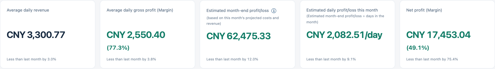

# CHANGELOG

**[← Back to the English README](README.en.md)** · [中文更新日志](<CHANGELOG (中文).md>)

## Versions

- [2026 Nov 10 V1.0.2](#2026-nov-10-v102) — Profit forecasts, expense analysis, and cash reconciliation
- [2026 Nov 07 V1.0.1](#2026-nov-07-v101) — Corrections to ledger entries, inventory values, cash balances, and synchronization
- [2026 Oct 30 V1.0.0](#2026-oct-30-v100) — First archived release

## 2026 Nov 10 V1.0.2

### Dashboard and monthly report

**Changed the monthly overview from four cards to five.** V1.0.1 showed revenue, total cost, net profit, and customer count. The new overview drops the separate cards for total cost and customer count. Each card now compares its value with the same metric for the previous month.

| Dashboard card, from left to right | Change from V1.0.1 | Current-month calculation |
| --- | --- | --- |
| Average daily revenue | **Changed.** Replaces the monthly revenue card. The full report already showed the daily average. | Revenue from the first of the month through yesterday divided by the number of calendar days in that period. |
| Average daily gross profit (Margin) | **Added to the dashboard.** Previously shown in the full report. | Gross profit through yesterday divided by the same number of days, with the gross margin for that period. |
| Estimated month-end profit/loss | **Added to the dashboard.** The existing report forecast also uses a revised cost calculation. | Projected revenue less projected costs for the whole month. The caption reads **(based on this month’s projected costs and revenue)**. |
| Estimated daily profit/loss this month | **New metric.** Shows the daily equivalent of the month-end estimate. | The unrounded month-end estimate divided by the number of calendar days in the month, expressed in CNY per day. The caption reads **(Estimated month-end profit/loss ÷ days in the month)**. |
| Net profit (Margin) | **Changed.** Moved from third to fifth. The margin now appears beside the amount, with the monthly comparison below. | Actual revenue less expenses through today, including the fixed expenses saved for the whole month. Net margin is actual net profit divided by actual revenue. |

Each monthly comparison shows a percentage when both values are available. Equal values show 0.0%. If the previous value was zero and the current value differs, the card explains why the percentage is unavailable. Missing figures are marked as unavailable. The daily forecast comparison uses the length of each month. The full monthly report still lists actual average daily net profit separately. For the current month, it divides actual net profit through today by the calendar days elapsed through yesterday.

**Changed the break-even row.** The full report uses the revised forecast and a shorter label. When it projects a loss and the gross margin is positive, the row shows how much more daily revenue is needed to break even.

### Month-end forecast

**Changed how projected costs are calculated.** The previous forecast subtracted last month’s total costs from projected revenue. The dashboard and full monthly report now project fixed expenses, ingredient costs, and other costs separately. Projected revenue is average daily revenue through yesterday multiplied by the number of calendar days in the month. Subtracting the three projected costs gives the month-end profit or loss.

| Projected cost | Calculation |
| --- | --- |
| Fixed expenses | Take the higher of last month’s actual fixed expenses and this month’s saved fixed expenses. Use last month’s amount until a figure has been saved for this month. |
| Ingredients, including seasonings | Compare the two months’ daily ingredient costs. Multiply the higher daily rate by the number of days in the current month. |
| Other costs | For each month, subtract ingredient costs (including seasonings) and fixed expenses from total costs. Compare the resulting daily rates and multiply the higher rate by the number of days in the current month. |

A purchase or expense dated today can change projected costs as soon as it is saved. Today’s revenue enters the forecast tomorrow. Last month’s daily rates use its full calendar month. This month’s rates use the days elapsed through yesterday, including dates with no entries.

The current-month forecast requires at least one daily operating record dated before today and either a daily record or a saved monthly cost record for the previous month. A recorded zero counts. The estimate displays a dash on the first day of the month or when the required records are missing.

**Changed how completed months are reported.** At local midnight on the first of the following month, the completed month shows actual net profit. Its daily figure is actual net profit divided by the number of days in that month. Later corrections to the ledger update both amounts.

**Added a forecast breakdown** beside the estimate on the dashboard and in the full report. Open **ⓘ** to compare costs for the two months and see which values were used. The last three lines show projected average daily total cost, projected total cost, and projected revenue. Daily total cost uses the full length of the month. For a completed month, the same lines show actual costs and revenue. The breakdown updates after a save or sync, including in Advanced analytics, and keeps the selected month.

### Charts and expense analysis

- **Changed the daily trend** to open on revenue. **Added a separate metric selector to the weekday chart**, which previously showed only net profit. It also opens on revenue. Either chart can show revenue, gross profit, net profit, or ingredient costs including seasonings. Weekday averages use recorded dates for the selected weekday.
- **Changed the cost breakdown colors and fixed the mobile alignment.** Each category has a distinct color shared by the ring and its legend. The total and its currency unit are centered in the ring on phones.
- **Added summaries to Analytics.** The operating view counts profitable days. The expense view identifies the largest expense category and the difference between monthly fixed expenses and itemized payments. The customer view identifies the busiest recorded day.
- **Added line and bar chart controls** with the average, range, and observation count. **Fixed overlapping horizontal-axis labels** on phones and desktops. Individual values remain accessible by mouse, touch, and keyboard.
- **Added column sorting and totals for filtered rows** in the detail table. On desktop, the active filters stay in view and the CSV export is available with the table collapsed. The export includes every matching row across pages.

### Cash reconciliation, language support, and deployment

- **Removed the duplicate balance adjustment form** from the cash sheet. The existing **Add cash entry → Balance override** sets a selected date’s cash balance to the amount counted. Earlier transactions and their editing restrictions are preserved.
- **Extended English coverage in the web interface** to previously untranslated text in forms, reports, charts, dialogs, errors, and audit summaries. User-entered names and notes keep their original wording. Some automatic cash descriptions, including the one for daily revenue, still appear in Chinese in English mode. Amounts are in CNY. The native macOS app uses Chinese.
- **Changed deployment verification** to match JavaScript and CSS asset URLs to the browser build identifier. It continues to check file hashes. The application and API report `v1.0.2`, and the browser build is `20261112-daily-pl`. [Deployment Guide](docs/DEPLOYMENT.md) · [Engineering Reference](docs/ENGINEERING_REFERENCE.md)

## 2026 Nov 07 V1.0.1

### Ledger entries, purchases, and reports

- **Fixed expense totals.** Deleting the last line in an ingredient, seasoning, or other-expense entry clears the corresponding total. Opening and saving an older entry that contains only an amount preserves that amount.
- **Fixed purchase detail handling.** Separate purchases with the same item name retain their own quantities, units, and prices. Moving selected lines moves only those lines. Purchase details preserve notes and punctuation, distinguish a missing price from a zero price, and calculate a missing total when both quantity and unit price are available.
- **Fixed older records and ledger refreshes.** Editing a single day in an older multi-day record preserves the other days’ dishes and expenses. A date without dish entries opens with an empty dish list. Switching ledgers during a save or refresh keeps each update with the correct ledger. The cash sheet refreshes after a save and discards older responses.
- **Fixed chart grouping and report display.** Purchase and consumption charts group items by name and unit. Inventory details show the remaining book value of each first-in, first-out (FIFO) lot to the cent. Long forecast labels wrap in the full report.

### Cash records, permissions, and internal backups

- **Fixed editing restrictions.** Temporary editing access applies to the authorized business dates. Revenue and expense totals inherit their entries’ editing deadlines, including after an older record is converted. The general API and synchronization endpoints enforce the same role restrictions as the cash sheet.
- **Fixed cash migration, duplicate totals, and restore order.** The system checks record versions when migrating cash records saved under older names. When several records cover the same business date, that date is counted once in cash totals. Internal Excel backups preserve which record takes precedence on restore.

### Desktop and upgrade notes

- **Fixed desktop synchronization and cash balances.** Edits made during an upload remain queued for the next sync. Cash balances include transactions across calendar years within the same ledger. A cash window or ledger form opened before a change on another device detects the conflict before saving.
- **Fixed report and cash totals.** Weekly totals include fixed expenses on days the restaurant was closed. Monthly and annual reports include months with only fixed expenses. Cash totals include older entries that contain only a revenue total and preserve explicitly recorded zeros.
- **Fixed workbook validation and recovery.** Before replacing an internal workbook, the desktop app checks Excel cell limits, JSON records, and record hashes. Recovery from an annual workbook also retrieves cloud records for the ledger’s other years.
- **Changed version reporting.** The API, web app, server archive, and macOS app use the same version label.

**Release verification.** Testing covered 148 backend tests with 15 additional subtests, 232 web monetary calculation checks, and 1,020 FIFO checks. The packaged app was tested on Apple Silicon both natively and under Rosetta in Intel mode. It requires macOS 15 or later.

**Upgrade from V1.0.0.** Update the server and clients together, then create a new internal backup to preserve record precedence. Review historical expenses with empty detail lines individually. Some older entries legitimately contain only an amount. [V1.0.1 fixes and test results](https://github.com/JackieHe12345/restaurant-finance-and-inventory-management-system/blob/9ab90f8c546c33ebe5443fe57dbcc775148474e7/CHANGELOG.md)

## 2026 Oct 30 V1.0.0

**Initial release.** The first release introduced daily sales records, purchasing, ingredient consumption by dish, inventory, cash balances, operating reports, and Excel import and export. The web app, API, and desktop app identified the build as `Oct30LingChen`. The source is archived as V1.0.0. [V1.0.0 source](https://github.com/JackieHe12345/restaurant-finance-and-inventory-management-system/tree/old/v1.0.0)
