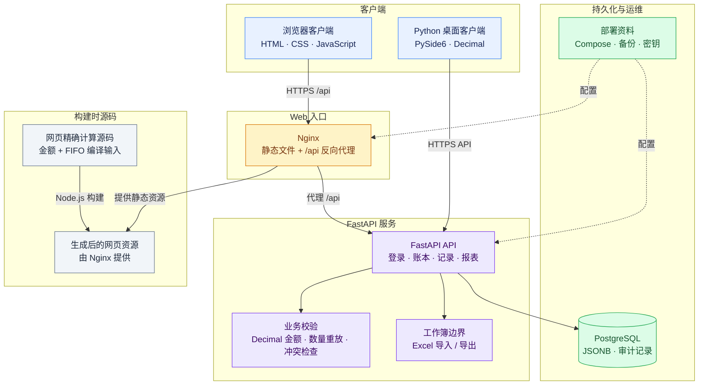

# restaurant-finance-and-inventory-management-system

[English README](README.md) · [English deployment guide](docs/DEPLOYMENT.md) · [中文部署指南](docs/DEPLOYMENT.zh-CN.md)

`restaurant-finance-and-inventory-management-system` 将餐饮日常记账、采购、库存出入库、固定支出、现金余额和经营统计放在同一个系统中。一套账本可以分别记录 A/B 店的收入渠道；多套独立账本各自保存记录，并通过账号与账本的绑定关系控制访问。网页端和 Python 桌面端通过云端 API 交换记录，也支持 Excel 工作簿导入导出。

本仓库源码版本为 `Oct30LingChen`，包含网页、FastAPI 后端、桌面端源码、构建工具和测试。使用这些文件可以搭建一套独立实例，数据库和凭据由安装者自己创建。仓库不包含生产账本、商户私钥或打包后的 macOS 应用。

## 主要实现

| 工程问题 | 实现方法 | 对应代码 |
| --- | --- | --- |
| 金额经过 JSON、Excel 和 JavaScript 后产生精度变化 | Python `Decimal`、基于 `BigInt` 的网页十进制运行时，以及已知财务字段的显式舍入与规范化 | `backend/app/money.py`、`backend/app/money_routes.py`、`backend/app/excel_io.py`、`web/money.js` |
| 一次出库包含不同进价的库存 | 网页和桌面端重放入库批次，按累计耗用量分摊批次金额，保留分币余数 | `build/web-exact-source/inventory-fifo.js`、`desktop/restaurant_cost_manager.py`、`build/test_fifo_contract.py` |
| 浏览器里的库存已经过期，单据保存时可能超出实际余额 | API 锁定账本，从当前记录重建数量流水，检查新增缺口后才提交 | `backend/app/main.py`、`backend/app/inventory_balance.py`、`backend/app/inventory_validation.py` |
| 品名更正需要联动历史资料，又不能改掉原采购金额 | 先预览变更范围，检查预览是否过期，再在一个事务内更新，并保存持久化请求回执 | `backend/app/name_corrections.py`、`backend/app/ingredient_corrections.py` |
| 同一天的 JSON 记录里，每个字段和明细有不同的可修改期限 | 服务端单独记录收入、客数和明细项目的首次保存时间，不依赖整张记录的更新时间 | `backend/app/models.py`、`backend/app/main.py`、`backend/tests/test_dataset_api.py` |
| 月度固定费用和逐笔付款容易重复加总 | 统计界面将月度保存值与逐笔固定支出分为两种口径，同时提供分类和来源明细 | `build/web-exact-source/analytics-oct30.js`、`web/analytics-oct30.css` |

当前 API 回归测试通过 120 项测试和 13 个子测试；网页金额与业务检查通过 232 项断言。FIFO 契约包含 77 组 fixture、1,020 个流水/余额检查：**成本和批次分摊在网页与桌面端之间逐项比较，数量余额再与 API 比较**。API 没有第三套 FIFO 成本引擎。

## 系统的使用范围

网页包含经营仪表盘、日记账、现金余额表、月度统计、食材与佐料采购、库存单据、菜品耗用、Excel 账本、店铺设置、独立账本、账号、临时权限和修改记录。

日常操作可以按以下流程进行：

1. 按营业日期录入收入、客数和采购，保留 A/B 店各收入渠道的区分。
2. 采购记录形成库存入库事件，菜品实际食材用量形成出库事件；额外采购、领用、损耗和盘点通过库存单据记录。
3. 查看数量余额、来源批次、已知成本和待定价数量。盘点记录实盘结果，不悄悄改写原采购金额。
4. 查看收入、成本、现金变动和月度费用分类，需要核对时继续查看具体日期或费用来源。
5. 导出用户 Excel 进行本地工作，或使用管理员内部工作簿交换记录。账号、权限、审计和部署配置仍需数据库备份。

系统用于记账。收入字段里有金额，并不等于一笔支付已经完成。源码包含微信交易账单导入，但支付发起、支付回调、退款和结算处理不属于本系统已经实现的支付流程。

## 架构与分工




| 部分 | 技术 | 职责 |
| --- | --- | --- |
| 网页 | 原生 JavaScript、HTML、CSS、SVG；JSZip | 表单、报表、保存前预览、FIFO 成本和响应式界面 |
| API | Python 3.12、FastAPI、同步 SQLAlchemy Session、Pydantic | 登录、账本权限、记录写入、库存数量校验、现金计算和工作簿处理 |
| 数据库 | PostgreSQL、JSONB | 带版本的业务记录、账号、绑定关系、时限、冲突和审计 |
| 桌面源码 | Python、PySide6、pandas、Matplotlib、openpyxl | 原生记账界面、本地工作簿、云端交互和 FIFO 成本 |
| 构建与检查 | Node.js、Acorn、Python、pytest | 生成网页业务脚本并验证财务规则 |
| 本地部署 | Docker Compose、PostgreSQL、Uvicorn、Nginx | 在一个源下提供网页与 API 的独立实例 |

网页固定请求 `/api/v1`。Nginx 一边提供静态文件，一边将 `/api/` 原路径代理到 FastAPI。只用 `python -m http.server` 提供 `web/` 时，可以加载登录页面，但没有对应的登录 API。

正常运行使用 PostgreSQL。测试为 SQLAlchemy 的 PostgreSQL `JSONB` 类型注册 SQLite 编译适配，并将数据库引擎替换为隔离 fixture。这是测试设施，不代表系统提供 SQLite 生产运行模式。

## 精确金额计算

金额规则覆盖输入、计算、序列化和显示：

- 金额保留两位小数，单价最多六位，舍入方式为 `ROUND_HALF_UP`。
- 手工输入的单笔金额绝对值上限为 `999999999999.99`，单价上限为 `999999999999.999999`。有来源明细支持的派生合计和报表汇总，与单笔输入上限分开处理。
- 拒绝 `NaN`、无穷大、布尔值和非法金额文本。未知价格保持未知；明确填写的零单价仍是已知零成本。
- 新增或修改的已知金额字段保存为十进制字符串。日期、ID、人数和未知扩展字段，不会因为其中恰好有 `amount`、`price` 字段名就被一律转换。
- HTTP JSON 读取与数据库 JSON 序列化保留旧数字金额的十进制写法；Excel 导入在需要时读取原始 XML 数值文本，避免先接收经过二进制浮点处理的数值。

网页运行时使用 `BigInt` 系数和小数位数表示十进制。隐式把 Decimal 转成普通数字会报错，用来暴露遗漏的浮点运算。构建脚本通过 Acorn 解析审阅源码，将算术、比较等表达式转换为 `Exact` 辅助函数。辅助函数对十进制操作数执行精确计算，同时保留普通字符串、日期和 DOM 计数的语义。只有绘图坐标等边界会明确转换为普通数字，结果不回写为账务金额。

例如，`0.10 + 0.20` 得到 `0.30`，`1.005` 保存为 `1.01`；多条已保存明细先分别舍入，再合计。旧客户端已经丢失并保存下来的精度，无法从现有值反推出原始输入。

业务脚本应修改 `build/web-exact-source/` 中的源码，再重新生成 `web/` 里的对应文件。共用十进制运行时 `web/money.js` 和 HTML/CSS 静态资源直接在 `web/` 中维护，每项只保留一份，不由业务脚本编译器生成。浏览器加载生成后的脚本与静态资源，运行时不需要 Node.js、Acorn 或新增 CDN。

## FIFO 成本与数量校验

库存以“分类、品名、单位”为标识，不同单位分别管理。入库、菜品耗用、手工调整和盘点按业务日期重放；带有 `recorded_at` 的记录按操作时间排序，旧记录缺少时间时保留事件优先级与输入顺序的兼容规则。

网页和桌面端维护入库批次。每个批次保留原数量、原入账金额、已填写的原单价以及剩余数量。下一次耗用的成本为：

```text
四舍五入(批次原金额 × 累计耗用数量 / 批次原数量, 2)
− 此前已经分摊的金额
```

整批耗尽时，分配该批次全部剩余金额。这样分次出库不会多出或少掉几分钱。3 件合计 10.00 元，分三次各出 1 件，分摊为 3.33、3.34、3.33；若填写原单价 0.335000、3 件入账 1.01 元，分摊为 0.34、0.33、0.34，界面仍保留原单价 0.335000。

餐饮业务中的例子：

| 日期 | 入库 | 出库 | 出库成本 |
| --- | --- | --- | --- |
| 10 月 9 日 | 9 斤，每斤 20 元 | 8 斤 | 160.00 元，第一批剩 1 斤 |
| 10 月 10 日 | 10 斤，每斤 15 元 | 3 斤 | 1 × 20 + 2 × 15 = **50.00 元** |

第二次出库显示平均单价 **16.67 元/斤**。平均单价是展示值，成本不会用这个舍入后的数乘回去计算。如果耗用中有未定价库存，界面分别显示已知成本和待定价数量，不会把不完整成本显示成完整平均单价。

API 的职责不同：`replay_quantities()` 返回数量余额、每笔新增缺口和盘点前账面数量。写入路径根据当前记录重放数量，阻止不合法的库存变更；`inventory_validation.py` 还验证单据结构以及数量、单价、金额之间的关系。API 不独立计算 FIFO 批次成本。共同 fixture 分别验证网页/桌面成本精确一致，以及 API 数量余额在测试容差内一致。

## 记录、并发与权限

### 记录模型

| 模型 | 保存内容 |
| --- | --- |
| `AppUser` | 登录名、显示名称、bcrypt 密码哈希、角色和启用状态 |
| `Dataset` | 独立账本 ID、名称和结构版本 |
| `UserDatasetMembership` | 账号被允许访问的账本，以及默认账本标记 |
| `SyncRecord` | 唯一的 `(dataset_id, record_type, record_key)`、JSONB payload、校验和、版本、序号和删除状态 |
| `AuditLog` | 操作人、动作、来源、事件 ID、设备 ID、修改前后内容和版本变化 |
| `EntryTiming` | 服务端保存的首次写入时间，以及字段/明细级时间映射 |
| `TemporaryPermission` | 账号与账本的临时角色、允许的营业日期和生效时间段 |
| `SyncConflict` | 本地/云端版本和内容，以及冲突处理状态 |
| `InventoryNameCorrection` | 持久化的请求 ID、请求哈希和更正结果 |

`event_id` 和 `source` 属于写入请求及审计信息，不是 `SyncRecord` 的字段。写入时先规范化内容并重算校验和，再检查期望版本；不符合版本规则时创建冲突记录。库存单据必须带当前版本。规范化后没有变化的内容可以直接返回现有记录，不再重复写入；这不等于系统实现了通用的“事件恰好处理一次”日志。

账本行锁让库存校验与相关记录写入处于同一事务快照中。品名更正另有持久化幂等回执：同一个请求 ID 可以返回已保存结果，换了内容却复用同一个 ID 会被拒绝。

### 访问控制

JWT 标识账号，API 会重新读取账号并检查是否启用。非管理员必须明确绑定到所请求的账本。角色包括 `viewer`、`entry`、`editor`、`admin`，临时授权可以在限定营业日期和时间内提供相应权限。

录入时限使用服务端时间。收入与客数字段各有首次保存时钟；明细项目有修改时钟，并受共享的新增明细窗口约束。主要窗口是 30 分钟修改期和 12 小时日明细新增期，此外还有 `main.py` 中的营业日期和收入截止时间规则。修改 JSON 中的时间或保存无关字段，不会重新打开这些窗口。

审计是可查看的修改历史，不是不可删除的永久归档：系统有 366 天保留策略和管理员维护接口。需要更长留存或故障恢复时，仍然要保存数据库备份。

### 品名更正

预览会列出受影响的采购、库存行、菜品食材、词典和设置。管理员核对预览，并按单位填写实际清点数量后再应用。原采购数量、单价、金额和备注保留，不同单位不靠推测换算合并。

例如两种拼写的库存分别是 2 桶和 3 桶，实际清点为 7 桶，更正可以统一品名并带原因记录 +2 桶调整。系统不会将品名中的数字猜成数量。应用过程在一个事务内完成，会检查预览是否过期，幂等回执也不依赖审计记录是否仍在保留期内。

## 报表和核算口径

仪表盘先展示所选月份的收入、总成本、利润和客数。月度成本包含整月固定成本；日明细按原有的日分摊规则核算。完整旧报表保留在展开区域中。

统计工作区提供经营、费用和客流视图。查看人工费用时，选择月份，进入费用分析，再选择“人工”类别；来源表可以搜索并导出 CSV。费用有两种口径：

- **月度支出汇总**：日流水中的采购和支出，加上已保存的月度人工、房租等固定金额。
- **逐笔固定支出**：按具体日期记录的固定支出，用于与月度汇总核对，不再重复相加。

采购支出和 FIFO 出库成本回答的是不同问题。费用视图沿用账本的采购/支出口径，批次耗用成本在库存模块查看。因此，月度利润并不能直接被描述为按 FIFO 销货成本计算的利润。

图表使用 SVG，跟随容器宽度重绘，未录入日期保留空缺，点按或键盘聚焦可以查看数值。网页适配手机、平板和电脑，较宽的表格在自身区域内横向滚动。

## Excel 与微信账单

`excel_io.py` 支持用户工作簿和按记录组织的内部工作簿，区分替换与合并，保留未知扩展字段，并处理旧格式明细字符串。内部工作簿携带业务记录，不包含完整的账号、权限、审计和服务器配置，不能替代整库备份。

`wechat_pay.py`、`wechat_sync.py` 实现商户交易账单获取、解析和门店渠道映射。订单、退款、结算和手续费都使用金额辅助函数，凭据来自部署环境。当前 API 启动路径刻意不启动旧版调度线程，因此源码中保留调度代码不代表已经启用每日自动导入。

## 克隆、构建与测试

使用 Python 3.12 和当前 Node.js LTS。网页构建只需要 `build/js-transform` 下的 Acorn；API 测试不需要连接生产数据库。

```bash
git clone https://github.com/JackieHe12345/restaurant-finance-and-inventory-management-system.git
cd restaurant-finance-and-inventory-management-system

python3.12 -m venv .venv
. .venv/bin/activate
python -m pip install -r build/test-requirements.txt

npm ci --prefix build/js-transform
node build/compile_exact_web.cjs
node build/test_exact_web.cjs
node web/test_inventory_v2.js
node web/test_oct29_frontend.js
node web/test_sep11v1_frontend.js

(cd backend && PYTHONPATH=.:tests python -m pytest -q tests)
```

测试自行提供隔离数据库 fixture 和测试环境默认值，不应加载生产环境文件。`build/test-requirements.txt` 包含 API 依赖，以及 pytest、HTTPX 和测试所用的子测试支持。

FIFO 契约会导入桌面模块和网页引擎。在受支持的 macOS/Unix 环境安装额外依赖，并在网页编译后运行：

```bash
python -m pip install -r desktop/requirements.txt
python build/test_fifo_contract.py
```

`node` 需在 `PATH` 中，也可通过 `NODE_BINARY` 指定绝对路径。契约测试使用 Qt offscreen 模式。桌面依赖按 Python 3.12 验证，当前选用的 macOS wheel 要求 macOS 14 或更新版本。源码导入了 `fcntl`，本仓库不声称支持 Windows。在有图形会话的电脑上，可用 `python desktop/restaurant_cost_manager.py` 启动原生界面。

## 搭建独立实例

Compose 启动 PostgreSQL、API 和 Nginx，在同一个源下提供网页与 `/api/v1`。演示端口默认只绑定本机回环地址。

```bash
cp .env.example .env
chmod 600 .env
# 编辑 .env，分别设置 POSTGRES_PASSWORD、SECRET_KEY、ADMIN_PASSWORD。
# 可以在本机生成随机值，例如：openssl rand -hex 32

docker compose config --quiet
docker compose up --build -d
curl --fail http://127.0.0.1:8080/api/v1/health
```

打开 [http://127.0.0.1:8080](http://127.0.0.1:8080)，使用配置中的管理员登录。启动过程创建缺失的表和初始管理员，不会重设已有账号密码。随后在应用中创建独立账本，并给账号分配账本。公开配置默认关闭可选的 Test 快捷登录。

[中文部署指南](docs/DEPLOYMENT.zh-CN.md) 包含完整的新实例安装、原生 API 配置、Nginx 路由和已有 Ubuntu 服务升级步骤，也提供内容对应的[英文版](docs/DEPLOYMENT.md)。这是两条不同的部署路径：已有服务升级脚本不是 Compose 安装程序。

## 发布打包和核验

检查通过后，从仓库生成服务器发布包：

```bash
python build/make_release.py --output dist/restaurant-cloud-Oct30LingChen-deploy.tar.gz
```

压缩包根目录为 `restaurant-cloud-Oct30LingChen/`，包含 `api/`、`web_frontend/`、`VERSION`、Nginx 资料和部署/核验脚本，不包含数据库和运行密钥。打包器拒绝覆盖已有输出，再次构建时应另选路径。

`deploy/verify_release_files.py` 比较已安装 API/静态文件与指定发布目录，并检查 API 健康、版本和必要路由。`deploy/verify_deployment.py` 在 PostgreSQL 只读事务中生成业务记录摘要，对比升级前后证据，不打印账本内容。后者检查的是升级是否保留数据，不能代替完整交互验收。文档中的命令为两者显式指定私有证据目录。

| 检查 | 当前结果 | 覆盖范围 |
| --- | --- | --- |
| API pytest | 120 项通过，13 个子测试通过 | 账本访问、金额、库存校验、品名更正、Excel 和微信相关回归 |
| 网页精确金额检查 | 232 项通过 | 十进制计算、字段规范化、编辑器合计、旧明细和 FIFO 金额守恒 |
| FIFO 契约 | 77 组 fixture、1,020 个流水/余额检查通过 | 网页/桌面成本和批次精确一致，API 数量余额一致 |
| 既有网页回归脚本 | 通过 | 库存单据、客数字段、现金/历史记录和资源版本 |

以上是当前源码的本地自动化结果，不代表已验证每一种浏览器或实机，也不等于原生安装包和生产部署已经验收。

## 仓库结构

```text
backend/                  FastAPI 应用、依赖和 API 测试
  app/                    模型、路由、金额、库存和工作簿处理
  tests/                  隔离回归 fixture 与测试模块
web/                      静态网页和已生成的业务脚本
build/
  web-exact-source/       可编辑的业务 JavaScript 源码
  js-transform/          Acorn 依赖和 npm 锁文件
  compile_exact_web.cjs   源码到网页脚本的转换
  test_exact_web.cjs      网页金额与业务检查
  test_fifo_contract.py   网页/桌面成本和 API 数量检查
  make_release.py        服务器发布包生成器
desktop/                  原生 Python 源码和依赖
deploy/                   Nginx 配置、部署与核验工具
docs/DEPLOYMENT.zh-CN.md   中文安装和升级指南
docs/DEPLOYMENT.md         内容对应的英文部署指南
compose.yaml              独立本地 PostgreSQL/API/Nginx 实例
README.md                 英文文档
README (中文).md          中文文档
VERSION                   Oct30LingChen
```

## 当前边界

项目由 PostgreSQL API、静态网页和桌面源码客户端组成，不包含支付网关、银行对账服务、数据库高可用、集中监控或 CI 部署流水线。数据库初始化使用 SQLAlchemy `create_all` 和启动时特定的兼容字段补充，没有通用迁移框架；修改已有列时需要单独设计迁移。

桌面源码和网页在已测试的财务契约上保持一致，界面并不相同。构建签名或公证后的 macOS 应用、恢复完整服务器，以及核验生产部署，都属于克隆源码之后需要另行完成的工作。

## 许可证

MIT，见 [LICENSE](LICENSE)。
