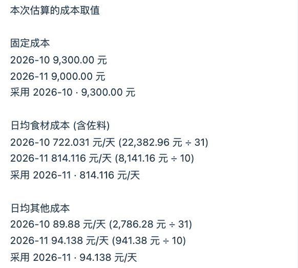

# 餐饮财务与库存管理系统

[English](README.md) · [更新日志](<CHANGELOG (中文).md>) · [部署指南](docs/DEPLOYMENT.zh-CN.md) · [工程技术参考](docs/ENGINEERING_REFERENCE.zh-CN.md)

包含自适应网页、FastAPI/PostgreSQL 后端和 Python 桌面客户端的餐饮记账系统，将收入、费用、采购、库存、菜品消耗和经营报表关联起来。

当前版本为 **v1.0.2**，网页构建修订为 **`20261111-live-forecast-r2`**。历史源码保留在 `old/v1.0.0` 和 `old/V1.0.1`；其中 V1.0.0 原程序内部名称为 `Oct30LingChen`。

## 主要功能

- 独立账本、门店收入渠道、用户角色和限时修改权限。
- 收入、客人数、采购、固定费用、现金流水及 Excel 导入导出。
- 食材入库、出库、损耗、盘点和 FIFO 批次成本，明确区分未定价数量。
- 主页五项指标和完整月报使用同一套月底盈亏预测。收入算到昨天，成本计入今天刚保存的采购和费用。打开 **i** 可以查看每项成本上月多少、本月多少、最后用了哪个值。已结束月份显示实际净利润。
- “本月趋势”和“各星期平均”默认显示收入，各自可切换为收入、毛利润、净利润或食材成本（含佐料）。
- 经营、费用和客流统计均可查看来源明细。
- 适配电脑和手机的图表、筛选、排序与 CSV 导出。
- 网页中英文界面；用户名称和备注保持原样。原生桌面界面为中文。

金额采用 Python `Decimal` 和基于 `BigInt` 的网页十进制运行库。采购支出与 FIFO 消耗成本属于不同口径；完整公式、模块、API、数据表和开发约束见[工程技术参考](docs/ENGINEERING_REFERENCE.zh-CN.md)。

## 看板预览

以下截图使用合成账本。本月趋势和各星期平均都默认显示营业收入，两张图可分别切换为营业收入、毛利润、净利润或食材成本（含佐料）。


<details>
<summary>查看十一月预计月底盈亏所用的成本</summary>

预测说明会逐项比较十月与十一月的成本。图中固定成本取自十月，日均食材成本和日均其他成本取自十一月。



</details>

## 搭建独立实例

Compose 启动 PostgreSQL、API 和 Nginx，在同一个源下提供网页与 `/api/v1`。演示端口默认只绑定本机回环地址。

```bash
cp .env.example .env
chmod 600 .env
# 编辑 .env，分别设置 POSTGRES_PASSWORD、SECRET_KEY、ADMIN_PASSWORD。
# 可以在本机生成随机值，例如：openssl rand -hex 32

docker compose config --quiet
docker compose up --build -d
curl --fail http://127.0.0.1:8080/api/v1/health
```

打开 [http://127.0.0.1:8080](http://127.0.0.1:8080)，使用配置中的管理员登录。启动过程创建缺失的表和初始管理员，不会重设已有账号密码。随后在应用中创建独立账本，并给账号分配账本。公开配置默认关闭可选的 Test 快捷登录。

[中文部署指南](docs/DEPLOYMENT.zh-CN.md) 包含完整的新实例安装、原生 API 配置、Nginx 路由和已有 Ubuntu 服务升级步骤，也提供内容对应的[英文版](docs/DEPLOYMENT.md)。这是两条不同的部署路径：已有服务升级脚本不是 Compose 安装程序。

## 仓库结构

```text
backend/                  FastAPI 应用、依赖和 API 测试
  app/                    模型、路由、金额、库存和工作簿处理
  tests/                  隔离回归 fixture 与测试模块
web/                      静态网页和已生成的业务脚本
build/
  web-exact-source/       可编辑的业务 JavaScript 源码
  js-transform/          Acorn 依赖和 npm 锁文件
  compile_exact_web.cjs   源码到网页脚本的转换
  test_exact_web.cjs      网页金额与业务检查
  test_fifo_contract.py   网页/桌面成本和 API 数量检查
  make_release.py        服务器发布包生成器
desktop/                  原生 Python 源码和依赖
deploy/                   Nginx 配置、部署与核验工具
docs/                     中英文部署指南和工程技术参考
compose.yaml              独立本地 PostgreSQL/API/Nginx 实例
README.md                 英文文档
README (中文).md          中文文档
VERSION                   v1.0.2
```

## 开发与测试

使用 Python 3.12、Node.js 和 npm。网页构建只需要 `build/js-transform` 下的 Acorn；API 测试不需要连接生产数据库。

```bash
cd /path/to/restaurant-finance-and-inventory-management-system

python3.12 -m venv .venv
. .venv/bin/activate
python -m pip install -r build/test-requirements.txt

npm ci --prefix build/js-transform
node build/compile_exact_web.cjs
for test in web/test_*.js; do node "$test" || exit 1; done
node build/test_exact_web.cjs
node build/test_i18n_backend.cjs
python build/test_deployment_cache_revision.py
python build/test_distribution_privacy.py

(cd backend && PYTHONPATH=.:tests python -m pytest -q tests)
```

测试自行提供隔离数据库 fixture 和测试环境默认值，不应加载生产环境文件。`build/test-requirements.txt` 包含 API 依赖，以及 pytest、HTTPX 和测试所用的子测试支持。

FIFO 契约会导入桌面模块和网页引擎。在受支持的 macOS/Unix 环境安装额外依赖，并在网页编译后运行：

```bash
python -m pip install -r desktop/requirements.txt
python build/test_fifo_contract.py
```

`node` 需在 `PATH` 中，也可通过 `NODE_BINARY` 指定绝对路径。契约测试使用 Qt offscreen 模式。源码测试使用 macOS 上的 Python 3.12。原生依赖有各自的系统要求，重建 App 时需检查完整运行库的最低系统版本。源码导入了 `fcntl`，本仓库不声称支持 Windows。在有图形会话的电脑上，可用 `python desktop/restaurant_cost_manager.py` 启动原生界面。

## 发布打包和核验

检查通过后，从仓库生成服务器发布包：

```bash
python build/make_release.py --output dist/restaurant-cloud-v1.0.2-deploy.tar.gz
```

压缩包根目录为 `restaurant-cloud-v1.0.2/`，包含 `api/`、`web_frontend/`、`VERSION`、Nginx 资料和部署/核验脚本，不包含数据库和运行密钥。打包器拒绝覆盖已有输出，再次构建时应另选路径。

`deploy/verify_release_files.py` 比较已安装 API/静态文件与指定发布目录，并检查 API 健康、版本和必要路由。`deploy/verify_deployment.py` 在 PostgreSQL 只读事务中生成业务记录摘要，对比升级前后证据，不打印账本内容。后者检查的是升级是否保留数据，不能代替完整交互验收。文档中的命令为两者显式指定私有证据目录。

自动生成的日志、验收截图、CSV、构建清单和部署证据写入 `work/`、`dist/` 等被 Git 忽略的目录。App、ZIP、业务数据和运行凭据不进入源码仓库。测试脚本、合成 fixture、构建工具和第三方许可证继续纳入版本管理。

浏览器验收、桌面测试、macOS 双架构重建和完整分发打包步骤见[工程技术参考](docs/ENGINEERING_REFERENCE.zh-CN.md)。

## 当前边界

项目由 PostgreSQL API、静态网页和桌面源码客户端组成，不包含支付网关、银行对账服务、数据库高可用、集中监控或 CI 部署流水线。数据库初始化使用 SQLAlchemy `create_all` 和启动时特定的兼容字段补充，没有通用迁移框架；修改已有列时需要单独设计迁移。

桌面源码和网页在已测试的财务契约上保持一致，界面并不相同。构建签名或公证后的 macOS 应用、恢复完整服务器，以及核验生产部署，都属于克隆源码之后需要另行完成的工作。

## 许可证

MIT，见 [LICENSE](LICENSE)。
