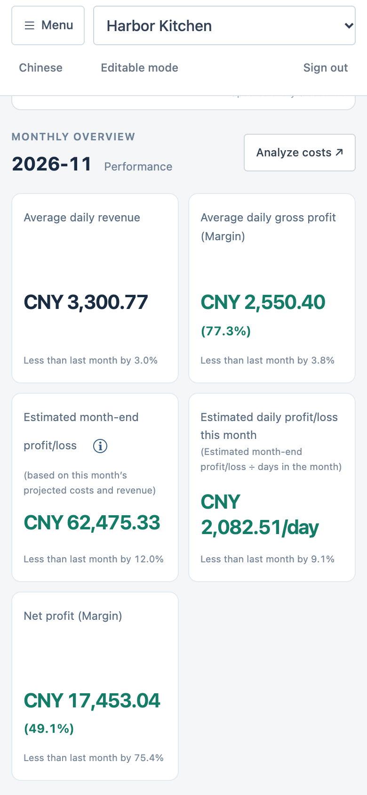
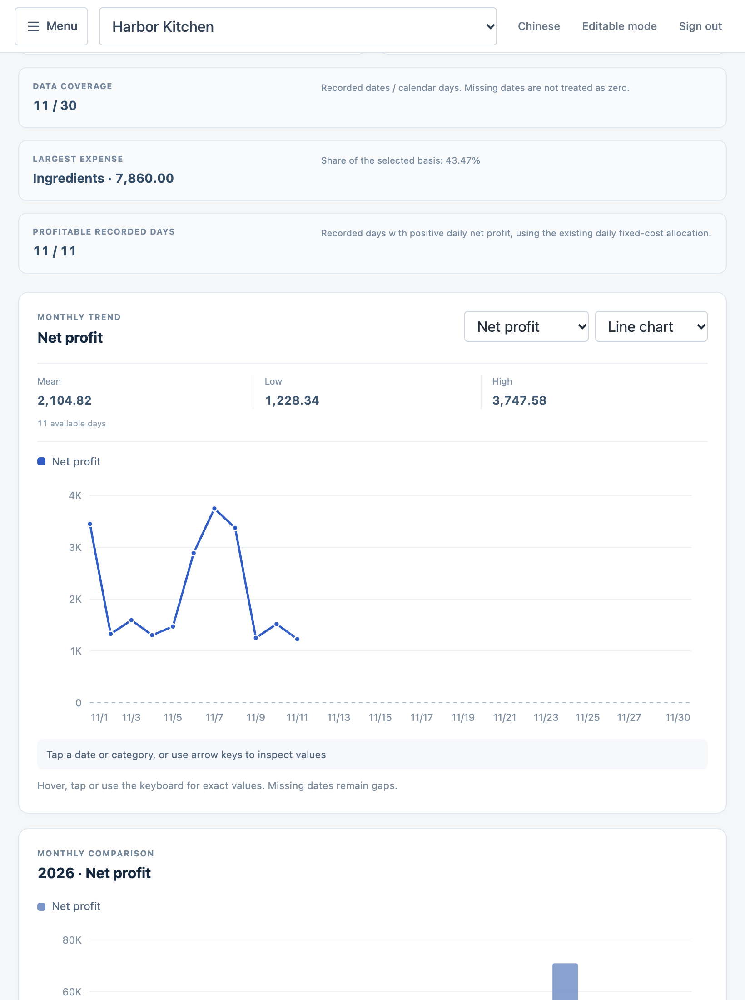
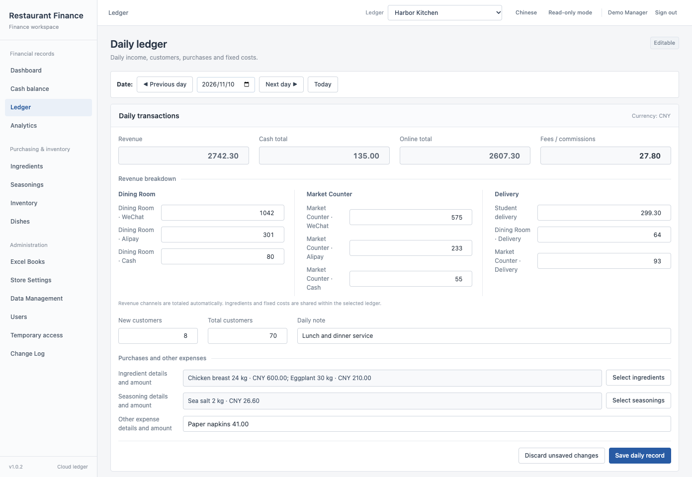
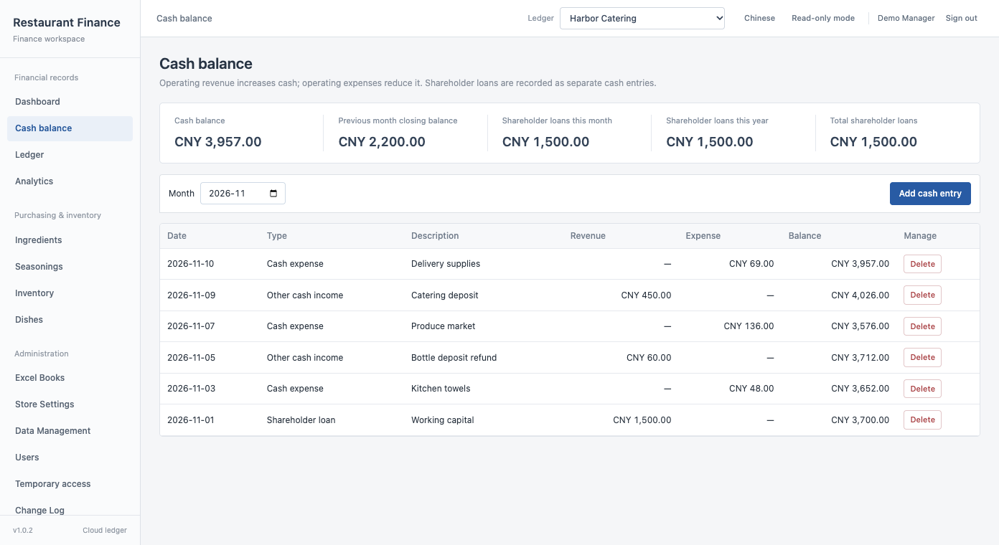
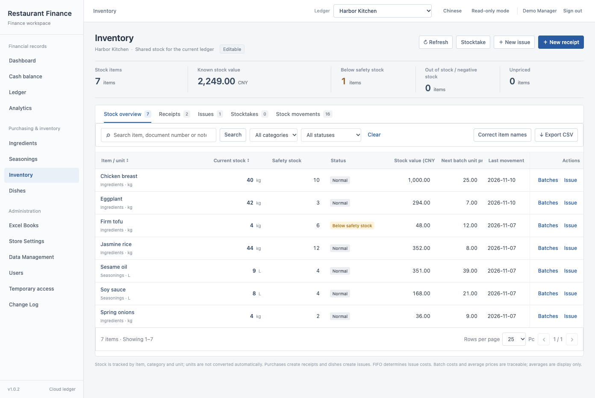
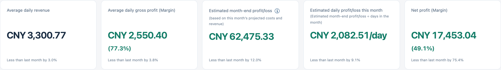

# Restaurant Finance and Inventory Management System

### **The README, CHANGELOG, Deployment Guide, and Engineering Reference are written in English and translated into Chinese. If the wording differs, the English edition takes precedence.**

### [简体中文](README.md) · [CHANGELOG](CHANGELOG.md) · [Deployment Guide](docs/DEPLOYMENT.md) · [Engineering Reference](docs/ENGINEERING_REFERENCE.md)

This system records restaurant sales, expenses, and inventory. Each ledger brings together daily sales by store and payment channel, ingredient purchases and usage, and monthly costs such as rent and wages. Managers can see actual net profit for the month to date, review the entries behind an expense, and estimate profit or loss at month-end.

The web app runs in desktop, tablet, and phone browsers. Each uses the same address and the ledgers assigned to the signed-in account. The interface supports English and Chinese. Store names, dish names, and notes keep their original wording in either language. The Chinese-language macOS app also supports local Excel workbooks and can sync them with the server.

## Phone and tablet views

The screenshots throughout this README show the English web interface with sample ledgers.

**Phone.** The ledger selector stays at the top of the screen. **Menu** opens the navigation drawer, and daily entry fields stack vertically to fit the display. On the dashboard, tap a chart point to read its date and value, or tap **ⓘ** beside the month-end forecast to see how it was calculated.



**Tablet.** In portrait orientation, the web app keeps the compact navigation and uses the additional width for reports and forms. In **Analytics**, select a reporting month and open the operating, expense, or customer view. Charts can be explored by touch. On a wide desktop display, the same pages have a persistent sidebar.



## Bookkeeping and inventory

**Stores and ledgers.** Two counters that share a kitchen can use one ledger. Enter each counter’s name in Store Settings to record its cash, WeChat Pay, Alipay, and delivery revenue separately. Shared purchases, rent, and wages are recorded once for the ledger. If the counters need separate inventories, expenses, and financial reports, create a ledger for each.

**Daily ledger.** Select a business date to record cash, online, and delivery takings for each counter. The form totals the channels and keeps payment fees separate. The same entry holds customer counts, notes, and purchases of ingredients and seasonings. Each purchase line has fields for quantity, unit, and price. Staff can check the day’s total against those entries. Wages, rent, and other monthly fixed costs are saved for their reporting month.



**Cash reconciliation.** The cash balance sheet is available to accounts with the Administrator or Editor role. Recorded operating receipts and expenses feed the balance. Shareholder loans are recorded separately. If a count differs from the book balance, enter the amount counted for that date using **Add cash entry → Balance override**. The adjustment appears in the transaction history and is excluded from operating profit. In English mode, some automatic descriptions still appear in Chinese, including the description for daily revenue.



**Stock and kitchen usage.** Suppose there is no rice in stock. Recording a 10 kg purchase for CNY 80 in the daily ledger books the expense and creates a stock receipt automatically. Issuing 2 kg to the kitchen leaves 8 kg in stock and assigns CNY 16 to that issue. If deliveries have different prices, issues draw from the oldest remaining lot first (FIFO). Stock records also show losses, stocktake adjustments, and quantities with an unknown price. Monthly profit includes the purchase expense. Kitchen issues and dish costs can be reviewed separately without counting the purchase twice.

The on-hand view lets staff check the balance of an item and follow its receipts and issues. When a physical count differs from the recorded quantity, a stocktake records the difference as an adjustment. Low-stock thresholds can be set per item. Missing prices are identified separately so that unpriced stock is distinguishable from stock recorded at zero cost.



**User roles and temporary permissions.** Administrators assign ledgers to staff accounts. Viewers can read their assigned ledgers. Entry users can record daily figures and correct them within the permitted time. Editors can amend existing records. If an error is found after the correction window closes, an administrator can grant temporary access for a particular ledger and range of business dates. For example, an administrator can allow a staff member to correct yesterday’s records in one ledger until 3 p.m. today. The permission expires at that time.

**Operating reports and source records.** The operations view shows how many recorded days were profitable. The expense view shows which categories account for the most spending. Compare monthly fixed costs with the dated payments recorded against them to find differences without adding the two figures together. The customer view identifies the busiest recorded day. Filter or sort the detail table to review specific entries. Totals and CSV exports cover the full filtered selection across pages.

**Excel workbooks.** Staff can download an annual business workbook for an assigned ledger. An administrator can merge an incoming workbook with the selected ledger or replace that ledger’s data. A separate internal workbook preserves the structured records used by the application. For a full server backup, the database and runtime configuration are covered in the [Deployment Guide](docs/DEPLOYMENT.md).

## Dashboard

The five cards show average daily revenue, average daily gross profit with its margin, estimated month-end profit or loss, estimated daily profit or loss for the month, and actual net profit with its margin. For the current month, the first two averages use figures through yesterday. Actual net profit includes today’s recorded transactions and the fixed costs saved for the full month.



In this sample ledger, the November forecast is **CNY 62,475.33**. Spread over the month’s 30 calendar days, that is **CNY 2,082.51 per day**, 9.1% below October’s actual daily average. Gross profit deducts ingredients, seasonings, and payment fees from revenue. Net profit also deducts other daily expenses, such as utilities, and the month’s fixed costs.

<details>
<summary>Month-end forecast calculation</summary>

Projected revenue is average daily revenue through yesterday multiplied by the number of calendar days in the month. The forecast deducts three projected costs from that revenue. For fixed costs, it takes the higher monthly amount recorded for this month or last month. For ingredients (including seasonings) and other costs, it compares the two months’ daily rates separately and multiplies each higher rate by the number of days in the current month. A purchase recorded today can change the forecast. From the first day of the following month, the dashboard shows the completed month’s actual net profit.

Select **ⓘ** beside the forecast to see both months’ amounts and the value used for each cost. In the example below, the calculation uses October’s fixed costs and November’s two daily rates. The final three lines show projected average daily cost, total cost, and revenue for November.


</details>

<details>
<summary>Daily trends, weekday averages, and the cost breakdown</summary>

**Daily and weekday trends.** The daily chart shows each date separately. The weekday chart averages the recorded dates for each weekday in the selected month. Both initially show revenue. Each chart can also display gross profit, net profit, or ingredient costs including seasonings.


**Daily cost breakdown.** Select a date to see its total cost in the center of the ring. The legend lists the amount and share for each category.


</details>

## Local installation

From a fresh checkout, use Docker Compose v2 to run PostgreSQL, the API, and the web server together. Copy the configuration template from the repository root.

```bash
cp .env.example .env
chmod 600 .env
```

Open `.env` and set distinct values for `POSTGRES_PASSWORD`, `SECRET_KEY`, and `ADMIN_PASSWORD`. To generate them, run `openssl rand -hex 32` separately for each value or use the configuration script in the [Deployment Guide](docs/DEPLOYMENT.md). Start the services and check the API.

```bash
docker compose config --quiet
docker compose up --build -d
curl --fail --retry 12 --retry-connrefused --retry-delay 2 http://127.0.0.1:8080/api/v1/health
```

Open <http://127.0.0.1:8080> and sign in with the administrator credentials from `.env`. The default username is `admin`. Create a ledger in **Excel Books**, then assign it to staff under **Users**. The default configuration accepts connections from your computer only. The startup password applies when the administrator account is first created.

Server installation, database backups, and upgrades to an existing Ubuntu service are covered in the [Deployment Guide](docs/DEPLOYMENT.md).

## Source code and development

| Component | Source and build instructions |
| --- | --- |
| Web interface | The page, stylesheets, and language files are in `web/`. Edit business calculations in `build/web-exact-source/`, then run `node build/compile_exact_web.cjs` to regenerate the scripts the browser loads. |
| API and database | `backend/app/` contains the FastAPI routes, SQLAlchemy models, permission checks, financial calculations, and Excel import and export code. Tests are in `backend/tests/`. Production data is stored in PostgreSQL. Changes to existing columns require a migration. |
| macOS app | The PySide6 entry point is `desktop/restaurant_cost_manager.py`. Install `desktop/requirements.txt`, then run `python desktop/restaurant_cost_manager.py` in a graphical session. |
| Installation and upgrades | `compose.yaml` starts a new instance. The scripts in `deploy/` upgrade and verify an existing native Ubuntu service. `build/make_release.py` builds the server archive. |

The browser uses decimal arithmetic backed by `BigInt`. Python uses `Decimal`. The financial formulas, stock valuation rules, database tables, API routes, and test procedures are documented in the [Engineering Reference](docs/ENGINEERING_REFERENCE.md).

### Running the tests

Use Python 3.12, Node.js, and npm. Run the following commands from the repository root to create a test environment, install the compiler dependency from the lockfile, and run the web and API tests. The API suite creates its own test database and uses its own configuration.

```bash
python3.12 -m venv .venv
. .venv/bin/activate
python -m pip install -r build/test-requirements.txt
npm ci --prefix build/js-transform
node build/compile_exact_web.cjs

for test in web/test_*.js; do node "$test" || exit 1; done
node build/test_exact_web.cjs
node build/test_i18n_backend.cjs
python build/test_deployment_cache_revision.py
python build/test_distribution_privacy.py
(cd backend && PYTHONPATH=.:tests python -m pytest -q tests)
```

On a supported macOS or Unix machine, the FIFO tests compare the desktop and browser calculations. They run Qt offscreen and use the `node` executable on `PATH` or the path supplied in `NODE_BINARY`. The desktop source uses the Unix module `fcntl`.

```bash
python -m pip install -r desktop/requirements.txt
python build/test_fifo_contract.py
```

### Server archive

```bash
python build/make_release.py --output dist/restaurant-cloud-v1.0.2-deploy.tar.gz
```

The archive contains the API, web files, Nginx configuration, and deployment utilities under `restaurant-cloud-v1.0.2/`. Use a new output filename for each build. Store production credentials and database backups separately. After an upgrade, `deploy/verify_release_files.py` checks installed files and HTTP endpoints. `deploy/verify_deployment.py` compares database records before and after the upgrade. Both procedures are documented in the [Deployment Guide](docs/DEPLOYMENT.md).

## Version and license

**v1.0.2** · Web build `20261112-daily-pl`. Earlier source is available for [V1.0.1](https://github.com/JackieHe12345/restaurant-finance-and-inventory-management-system/tree/old/V1.0.1) and [V1.0.0](https://github.com/JackieHe12345/restaurant-finance-and-inventory-management-system/tree/old/v1.0.0). The V1.0.0 source identifies the original build as `Oct30LingChen`. Release history is in the [CHANGELOG](CHANGELOG.md).

Released under the [MIT License](LICENSE).
