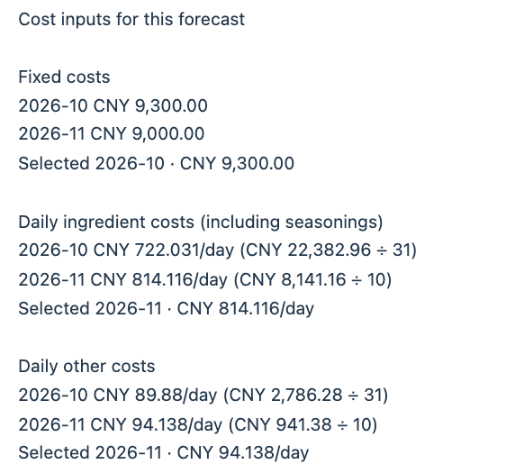
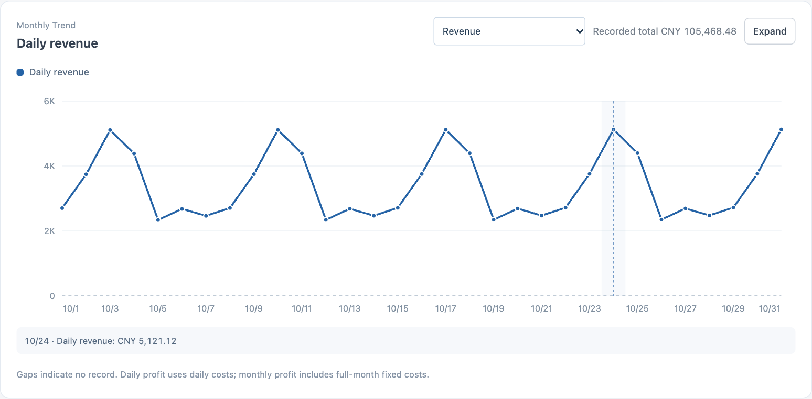
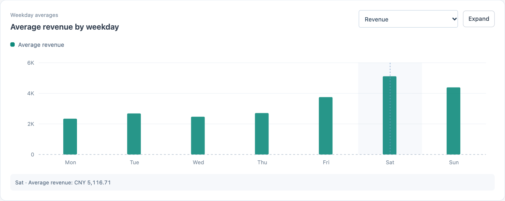
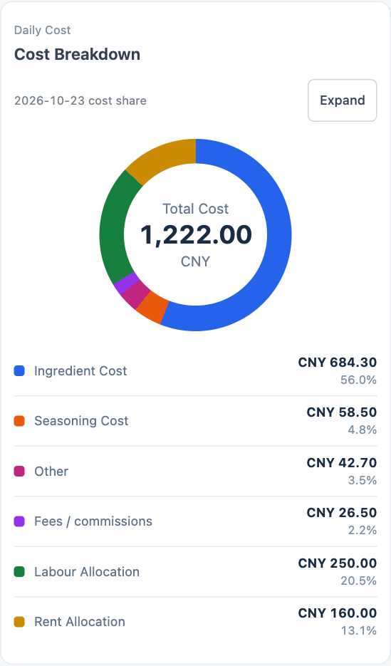

# Restaurant Finance and Inventory Management System

**The README, changelog, deployment guide and engineering reference are written in English and translated into Chinese. If the wording differs, the English edition takes precedence.**

**[简体中文](README.md)** · [Changelog](CHANGELOG.md) · [Deployment guide](docs/DEPLOYMENT.md) · [Engineering reference](docs/ENGINEERING_REFERENCE.md)

At closing time, enter what the restaurant took in, what the kitchen bought and how many customers came in. During the month, add bills such as rent and wages. The dashboard brings those entries together so you can see how much the restaurant has earned so far, where the money went and what profit or loss to expect by month-end. Staff can use the web app on a phone or computer. The macOS app also works with local Excel books and can sync with the server.

## How a restaurant uses it

**Keep two counters in one ledger, or keep two businesses separate.** Suppose two counters share a kitchen, staff and rent. Give each a name in Store Settings. In the same ledger, record sales for each counter by payment channel, such as cash, WeChat Pay, Alipay or delivery. You can see what each counter brought in while counting their shared costs once. If the businesses keep separate stock, expenses and reports, create a ledger for each. An administrator chooses which ledgers each staff account can open.

**Record a day's trading.** Pick the business date and enter sales, payment fees, purchases of ingredients and seasonings, and any other expenses. Record customer counts if you want to compare busy and quiet days. Save wages, rent and other fixed costs for the month. The cash balance sheet also lets you record a shareholder loan or enter the balance you actually counted. Neither entry is counted as sales.

**Follow ingredients from delivery to the kitchen.** For example, if you start with no rice and buy 10 kg for CNY 80, the ledger records a purchase of CNY 80. Issue 2 kg to the kitchen and the stock record shows 8 kg left and CNY 16 used. With several deliveries at different prices, the system uses the oldest stock first (FIFO). It also records losses and stocktakes, and flags stock whose purchase price is unknown. The monthly profit report counts the purchase expense once. You can look at ingredient use and dish costs separately.

**Give staff the access they need.** A viewer can read the books assigned to them. An entry user can record daily figures and correct entries within the allowed time. An editor can amend records, and an administrator manages accounts and ledgers. If the usual correction window for yesterday’s purchase has closed, the administrator can give the staff member until a set time today to amend yesterday’s records in that ledger. The extra access expires automatically.

**Review the figures or take them into Excel.** Open Analytics to compare operating results, expenses or customer numbers with the previous month. Follow an expense category to the dated entries behind it, or filter and sort the details and export the current selection as CSV. For a spreadsheet copy of the books, download a business workbook for the year. Administrators can also merge or replace workbook data for the selected ledger.

The browser interface is available in Chinese and English. Store names, dishes and notes stay as entered when you switch languages. The macOS app uses Chinese.

## Reading the dashboard

The following figures come from a sample ledger. The first two cards show average daily revenue and gross profit through yesterday. The third projects **CNY 62,475.33** profit for November. The fourth divides that forecast by November’s 30 calendar days and shows **CNY 2,082.51/day**, 9.1% below October’s actual profit per day. The fifth shows actual net profit and its margin, including entries saved today and the fixed costs already recorded for the whole month.


Gross profit is revenue after ingredient purchases, seasonings and payment fees. Net profit also deducts day-to-day expenses such as utilities, along with the fixed costs recorded for the month.

<details>
<summary>How the month-end estimate is calculated</summary>

Multiply average daily revenue through yesterday by the number of calendar days in this month. Subtract the three projected costs below to get estimated month-end profit or loss. For each cost, the system compares this month with last month and uses the higher figure. Fixed expenses are compared as monthly amounts. Ingredients (including seasonings) and other costs are compared as daily rates, then multiplied by the days in this month. A purchase saved today can change the estimate immediately. Once the month ends, the card shows actual net profit for that month.

Open **ⓘ** beside the estimate to see both months’ figures and which one was used. In this example, October supplies the fixed cost and November supplies both daily rates. The last three lines show projected average daily total cost, total cost and revenue.



</details>

**Which days bring in the most revenue?** The daily trend shows individual dates. The weekday chart averages the recorded Mondays, Tuesdays and so on in the selected month. Both open on revenue. Each can also show gross profit, net profit or ingredient costs including seasonings.





**What did a particular day cost?** Select a date. On a phone, the ring shows the total in the center. The legend lists the amount and percentage for each category.



## Run the web app locally

From a fresh checkout, use Docker Compose v2 to start PostgreSQL, the API and the web server. Copy the settings template and open the copy in a text editor.

```bash
cp .env.example .env
chmod 600 .env
```

Set a separate value for `POSTGRES_PASSWORD`, `SECRET_KEY` and `ADMIN_PASSWORD`. Run `openssl rand -hex 32` once for each value, or use the configuration generator in the [deployment guide](docs/DEPLOYMENT.md). Then start the services.

```bash
docker compose config --quiet
docker compose up --build -d
curl --fail --retry 12 --retry-connrefused --retry-delay 2 http://127.0.0.1:8080/api/v1/health
```

Open <http://127.0.0.1:8080>. Sign in with the administrator username and password from `.env` (the default username is `admin`). Open **Excel Books** to create a ledger, then **Users** to assign it to staff. By default the site listens only on your computer. Once the administrator account exists, changing the startup password in `.env` leaves the account’s saved password in place.

For a server installation, database backup or upgrade of an existing Ubuntu service, follow the [deployment guide](docs/DEPLOYMENT.md).

## Where to make a change

| If you are working on… | Start here |
| --- | --- |
| The web interface | `web/index.html`, stylesheets and language files in `web/`. Edit the business calculations in `build/web-exact-source/`, then run `node build/compile_exact_web.cjs` to update the scripts the browser loads. |
| The API or stored data | `backend/app/` contains the FastAPI routes, SQLAlchemy models, permissions, money and Excel code. The regression tests are in `backend/tests/`. PostgreSQL stores the live data. Changes to existing database columns need an explicit migration. |
| The macOS app | `desktop/restaurant_cost_manager.py` and `desktop/requirements.txt`. The app uses PySide6. Run `python desktop/restaurant_cost_manager.py` from a graphical session after installing the dependencies. |
| Installation or upgrades | `compose.yaml` starts a new instance. The scripts in `deploy/` can upgrade and verify an existing native Ubuntu service. `build/make_release.py` builds the server archive. |

Browser calculations use decimal arithmetic backed by `BigInt`. Python uses `Decimal`. The [engineering reference](docs/ENGINEERING_REFERENCE.md) gives the financial formulas, inventory rules, database tables, API routes and browser and desktop test procedures.

### Run the tests

Use Python 3.12, Node.js and npm. From the repository root, create a test environment and install the locked JavaScript compiler dependency. The API tests create their own database fixtures. Leave production settings out of the test environment.

```bash
python3.12 -m venv .venv
. .venv/bin/activate
python -m pip install -r build/test-requirements.txt
npm ci --prefix build/js-transform
node build/compile_exact_web.cjs

for test in web/test_*.js; do node "$test" || exit 1; done
node build/test_exact_web.cjs
node build/test_i18n_backend.cjs
python build/test_deployment_cache_revision.py
python build/test_distribution_privacy.py
(cd backend && PYTHONPATH=.:tests python -m pytest -q tests)
```

On a supported macOS/Unix machine, run the FIFO tests against the desktop and browser calculations as well. These tests run Qt offscreen and use `node` from `PATH` or `NODE_BINARY`. The desktop source imports the Unix module `fcntl`.

```bash
python -m pip install -r desktop/requirements.txt
python build/test_fifo_contract.py
```

### Build a server archive

```bash
python build/make_release.py --output dist/restaurant-cloud-v1.0.2-deploy.tar.gz
```

The archive contains the API, web files, Nginx configuration and deployment tools under `restaurant-cloud-v1.0.2/`. Use a new output filename when rebuilding. Keep production credentials and database backups separately. After an upgrade, `deploy/verify_release_files.py` checks the installed files and HTTP endpoints. `deploy/verify_deployment.py` compares database records from before and after the upgrade. Both procedures are in the [deployment guide](docs/DEPLOYMENT.md).

## Version and license

**v1.0.2** · Browser build `20261112-daily-pl`. Earlier source is available in [V1.0.1](https://github.com/JackieHe12345/restaurant-finance-and-inventory-management-system/tree/old/V1.0.1) and [V1.0.0](https://github.com/JackieHe12345/restaurant-finance-and-inventory-management-system/tree/old/v1.0.0). The original V1.0.0 code calls that build `Oct30LingChen`. See the [changelog](CHANGELOG.md) for the changes in each release.

Released under the [MIT License](LICENSE).
