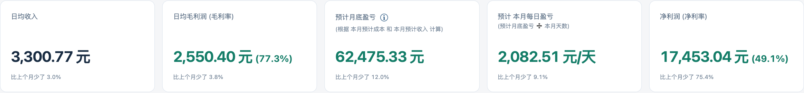
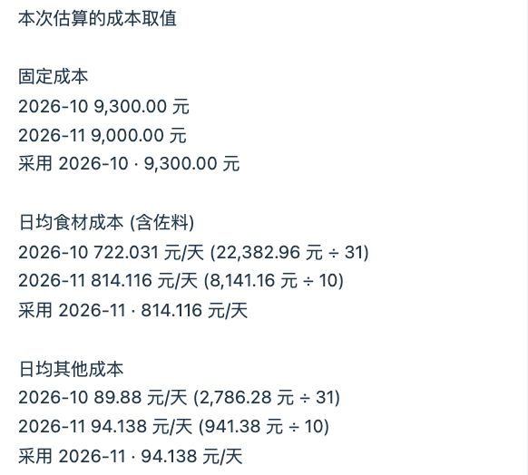
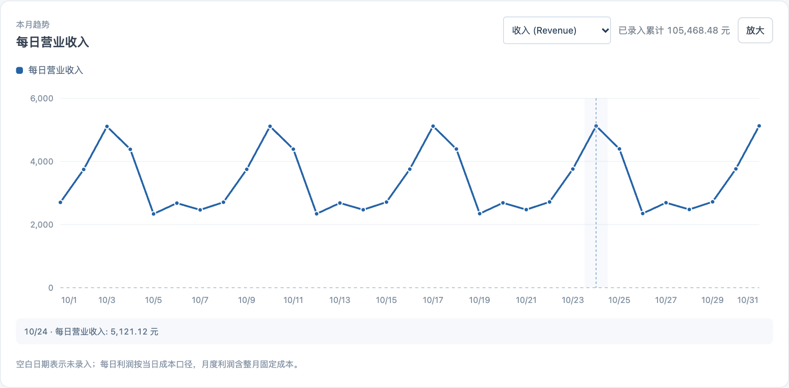
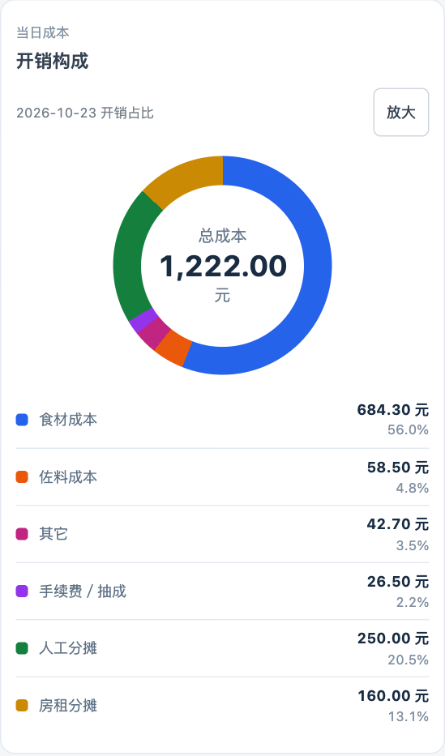

# 餐饮财务与库存管理系统

**README、更新日志、部署指南和工程技术参考均以英文版为原稿。中英文表述如有出入，以英文版为准。**

**[English](README.en.md)** · [更新日志](<CHANGELOG (中文).md>) · [部署指南](docs/DEPLOYMENT.zh-CN.md) · [工程技术参考](docs/ENGINEERING_REFERENCE.zh-CN.md)

每天打烊时，可以用这套系统记下今天收了多少钱、厨房买了什么、来了多少客人。房租、工资等按月发生的费用也记进同一本账。打开经营仪表盘，就能看到这个月到目前为止赚了多少、钱花在哪里，以及照目前的收支情况，月底可能盈利还是亏损。店员用手机或电脑浏览器就能记账；macOS 桌面版还可以在本地使用 Excel 账本，并与服务器同步。

## 在店里怎么用

**两个档口共用厨房，可以合在一本账里；两门生意各算各的，就分开建账。** 比如，两个档口共用厨房、员工和铺面，可以在「店铺设置」里分别给它们起名。记账时，每个档口的现金、微信、支付宝和外卖收入分开填，食材、工资和房租等共同支出只记一次。这样既能看清各自收了多少钱，也能算出整体盈亏。如果两门生意的库存、费用和报表都要分开，就为它们各建一本账。管理员决定每个员工账号可以打开哪些账本。

**把一天的收支记清楚。** 先选营业日期，再填营业收入、手续费、食材和佐料采购，以及当天的其他支出。想比较哪天客人多，还可以填客人数。工资、租金等固定成本按月保存。在「现金余额表」里，还可以登记股东借款，或填入盘点后的实际余额。这两种操作都不会增加营业收入。

**从进货查到厨房领用。** 假设原来没有大米，今天花 80 元买了 10 公斤，账上就记一笔 80 元的采购。厨房领走 2 公斤，库存里能看到还剩 8 公斤，这次领用成本是 16 元。如果几批大米的进价不同，系统按先进先出（FIFO）计算，先用最早入库的那批。损耗和盘点也能登记，价格未知的库存会单独标明。月度利润里的这笔采购支出只扣一次，食材领用了多少、菜品耗用了多少钱可以另查。

**让店员做自己该做的事。** 只读账号可以查阅分配给自己的账本，录入账号可以填报每日收支，并在规定时间内更正。需要修改已有记录时，可使用有修改权限的账号；账号和账本由管理员管理。例如，店员今天发现昨天的一笔采购记错了，但已过了更正时限。管理员可以临时开放这本账昨天的记录，并指定店员今天几点前可以修改。到时，这项额外权限自动失效。

**月底查数，也可以导出 Excel。** 在「更多统计」里可以把经营结果、费用和客流与上月比较。某类费用偏高，可以点进去查是哪天记的、具体有哪些支出。明细支持筛选和排序，也可以把当前结果导出为 CSV。需要电子表格时，可按年份下载业务账本；管理员还可以为所选账本合并或替换 Excel 数据。

网页版支持中文和英文。切换语言时，店名、菜品名和备注保留录入时的原文。macOS 桌面版使用中文。

## 怎么读经营仪表盘

下面几张截图使用示例账本。前两张卡显示截至昨天的日均收入和日均毛利润。第三张卡预计十一月底盈利 **62,475.33 元**。第四张卡把这个预测值除以十一月的 30 个自然日，得到 **2,082.51 元/天**，比十月实际平均每天赚的钱少了 9.1%。第五张卡显示截至目前的实际净利润和净利率，今天刚记的收支和已保存的整月固定成本都算在内。



读这两种利润时，可以先看各自扣了哪些钱。毛利润从营业收入里扣掉食材、佐料和手续费。算净利润时，还要扣当天记的水电杂费等支出，以及账上这个月的固定成本。

<details>
<summary>月底盈亏是怎么算出来的？</summary>

用截至昨天的日均收入乘以本月的自然天数，就得到本月预计收入。再减去三项预计成本，就是预计月底盈亏。每项成本分别比较本月和上月，取两者中较高的一个。固定成本比较整月金额；食材（含佐料）和其他成本比较日均金额，再乘以本月天数。今天新记的一笔采购就可能改变预测。进入下个月后，回看这个月，卡片显示实际净利润。

点开指标旁边的 **ⓘ**，可以看到两个月各是多少、最后用了哪个数。图中固定成本取十月的金额，食材和其他成本都取十一月的日均金额。最下面三行依次是本月预计日均总成本、预计总成本和预计收入。



</details>

**哪些日子营业收入高？** 「本月趋势」按日期看，「各星期平均」则把所选月份有记录的周一放在一起算平均，周二至周日也各自计算。两张图默认显示收入，都可以单独切换为毛利润、净利润或食材成本（含佐料）。




**某一天的钱花在哪里？** 选好日期后，在手机上看开销构成，圆环中间是当天的总成本，图例列出各类费用的金额和占比。



## 在自己的电脑上运行网页版

首次从源码运行时，用 Docker Compose v2 启动 PostgreSQL、API 和网页服务器。在仓库根目录复制配置模板，再用文本编辑器打开副本。

```bash
cp .env.example .env
chmod 600 .env
```

分别设置 `POSTGRES_PASSWORD`、`SECRET_KEY` 和 `ADMIN_PASSWORD`。可以为每一项单独运行一次 `openssl rand -hex 32`，也可以用[部署指南](docs/DEPLOYMENT.zh-CN.md)里的脚本生成配置。然后启动服务。

```bash
docker compose config --quiet
docker compose up --build -d
curl --fail --retry 12 --retry-connrefused --retry-delay 2 http://127.0.0.1:8080/api/v1/health
```

打开 <http://127.0.0.1:8080>，用 `.env` 里的管理员账号和密码登录（默认用户名为 `admin`）。先到「Excel 账本」新建一本账，再到「用户管理」分配给店员。默认只有本机可以访问网页。管理员账号建好后，修改 `.env` 中的初始密码不会改变该账号已保存的密码。

服务器安装、数据库备份以及已有 Ubuntu 服务的升级步骤见[部署指南](docs/DEPLOYMENT.zh-CN.md)。

## 要改功能，从哪里入手

| 要改的部分 | 对应位置 |
| --- | --- |
| 网页界面 | 页面在 `web/index.html`，样式表和语言文件在 `web/`。业务计算的源码在 `build/web-exact-source/`；改好后运行 `node build/compile_exact_web.cjs`，生成浏览器实际加载的脚本。 |
| API 或数据存储 | `backend/app/` 包含 FastAPI 路由、SQLAlchemy 数据模型、权限、金额计算和 Excel 处理代码。回归测试在 `backend/tests/`。正式运行时用 PostgreSQL 保存数据，改动已有数据库字段需要编写迁移步骤。 |
| macOS 桌面版 | 入口为 `desktop/restaurant_cost_manager.py`，依赖列在 `desktop/requirements.txt`。界面使用 PySide6。装好依赖后，在有图形界面的环境运行 `python desktop/restaurant_cost_manager.py`。 |
| 安装或升级 | `compose.yaml` 用于启动新实例。`deploy/` 中的脚本用于升级和核验已有的原生 Ubuntu 服务。`build/make_release.py` 用于生成服务器部署包。 |

网页用基于 `BigInt` 的十进制运算处理金额，Python 使用 `Decimal`。财务公式、库存规则、数据库表、API 路由，以及网页和桌面版的测试方法，见[工程技术参考](docs/ENGINEERING_REFERENCE.zh-CN.md)。

### 运行测试

需要 Python 3.12、Node.js 和 npm。在仓库根目录创建测试环境，按锁文件安装 JavaScript 编译依赖。API 测试会创建自己的测试数据库，运行时不要加载生产配置。

```bash
python3.12 -m venv .venv
. .venv/bin/activate
python -m pip install -r build/test-requirements.txt
npm ci --prefix build/js-transform
node build/compile_exact_web.cjs

for test in web/test_*.js; do node "$test" || exit 1; done
node build/test_exact_web.cjs
node build/test_i18n_backend.cjs
python build/test_deployment_cache_revision.py
python build/test_distribution_privacy.py
(cd backend && PYTHONPATH=.:tests python -m pytest -q tests)
```

在受支持的 macOS 或 Unix 环境，还可以运行 FIFO 测试，核对桌面版和网页的计算结果。测试使用 Qt 的离屏模式，通过 `PATH` 或 `NODE_BINARY` 找到 `node`。桌面版源码用到了 Unix 模块 `fcntl`。

```bash
python -m pip install -r desktop/requirements.txt
python build/test_fifo_contract.py
```

### 生成服务器部署包

```bash
python build/make_release.py --output dist/restaurant-cloud-v1.0.2-deploy.tar.gz
```

部署包的根目录是 `restaurant-cloud-v1.0.2/`，里面有 API、网页文件、Nginx 配置和部署工具。再次构建时要换一个输出文件名。生产凭据和数据库备份另行保管。升级后，`deploy/verify_release_files.py` 可以核对已安装的文件和 HTTP 接口；`deploy/verify_deployment.py` 可以比对升级前后的数据库记录。两项操作的命令都在[部署指南](docs/DEPLOYMENT.zh-CN.md)里。

## 版本与许可证

**v1.0.2** · 网页构建号 `20261112-daily-pl`。早期源码见 [V1.0.1](https://github.com/JackieHe12345/restaurant-finance-and-inventory-management-system/tree/old/V1.0.1) 和 [V1.0.0](https://github.com/JackieHe12345/restaurant-finance-and-inventory-management-system/tree/old/v1.0.0)。V1.0.0 在早期程序里称为 `Oct30LingChen`。各版具体改动见[更新日志](<CHANGELOG (中文).md>)。

本项目采用 [MIT 许可证](LICENSE)。
