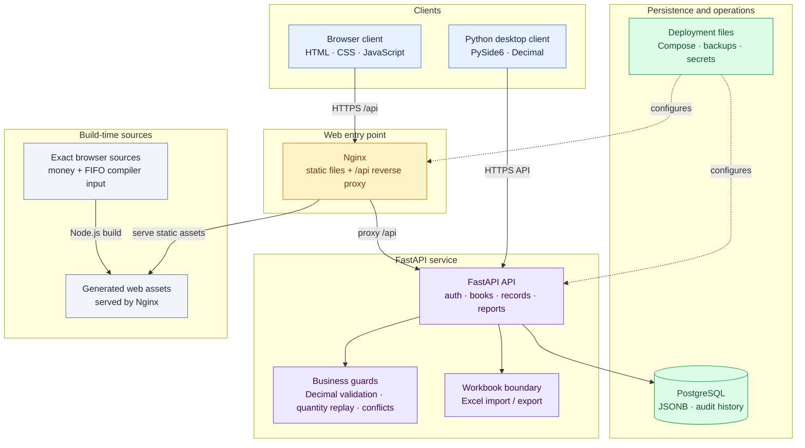

# restaurant-finance-and-inventory-management-system

[中文文档](<README (中文).md>) · [English deployment guide](docs/DEPLOYMENT.md) · [中文部署指南](docs/DEPLOYMENT.zh-CN.md)

`restaurant-finance-and-inventory-management-system` connects daily restaurant bookkeeping with purchasing, stock movements, fixed expenses, cash balances and operating reports. A book can record separate A/B store income channels; independent books have their own records and account memberships. The browser client and a Python desktop client work with the cloud API and exchange Excel workbooks.

The source in this repository is labelled `Oct30LingChen`. It includes the browser application, FastAPI backend, desktop source, build tools and tests. A fresh installation starts with its own database and credentials. Production records, merchant keys and packaged macOS binaries are not part of the repository.

## Implementation at a glance

| Engineering problem | Implementation | Evidence in the repository |
| --- | --- | --- |
| Money changes when it passes through JSON, Excel and JavaScript | Python `Decimal`, a browser decimal runtime backed by `BigInt`, explicit rounding and normalization of known financial fields | `backend/app/money.py`, `backend/app/money_routes.py`, `backend/app/excel_io.py`, `web/money.js` |
| One issue consumes stock purchased at different prices | The browser and desktop replay dated lots and allocate cost by cumulative consumption, preserving each lot's booked cents | `build/web-exact-source/inventory-fifo.js`, `desktop/restaurant_cost_manager.py`, `build/test_fifo_contract.py` |
| A document appears valid in a stale browser but no longer has enough stock | The API locks the dataset, reconstructs quantity movements from current records and checks new shortages before committing | `backend/app/main.py`, `backend/app/inventory_balance.py`, `backend/app/inventory_validation.py` |
| A spelling correction must update linked records without changing purchase history | Preview the write set, check its current state, apply changes in one transaction and retain a durable request receipt | `backend/app/name_corrections.py`, `backend/app/ingredient_corrections.py` |
| A daily JSON document contains entries with different editing deadlines | Server-owned timing maps track individual income fields, customer fields and detail items rather than relying on the document's last update time | `backend/app/models.py`, `backend/app/main.py`, `backend/tests/test_dataset_api.py` |
| Monthly expenses and dated payments can be counted twice | Analytics presents monthly saved amounts and itemized fixed expenses as separate bases, with categories and source details | `build/web-exact-source/analytics-oct30.js`, `web/analytics-oct30.css` |

The API suite currently passes 120 tests and 13 subtests. Browser money/business checks pass 232 assertions. The FIFO contract covers 77 fixtures and 1,020 movement/balance checks: it compares **cost and allocation results between the browser and desktop**, then compares **quantity balances with the API**. The API does not implement a third FIFO cost engine.

## Application scope

The web interface contains the operating dashboard, daily ledger, cash balance sheet, monthly analytics, ingredient and seasoning purchases, inventory documents, dish consumption, Excel exchange, store settings, datasets, accounts, temporary permissions and change history.

A typical workflow is:

1. Record income, customer counts and purchases for a business date. A/B income channels remain distinguishable within that day's ledger.
2. Purchases supply inventory receipt events. Actual ingredient usage in dishes supplies outbound events. Additional receipts, issues, losses and stocktakes are entered through inventory documents.
3. Inspect quantity balances, source batches, known costs and unpriced quantities. A stocktake records the counted quantity; it does not silently rewrite the original purchase amount.
4. Review revenue, costs, cash movements and monthly expense categories. Open the underlying dates or expense sources when a total needs explanation.
5. Export a user workbook for local work, or use the administrator workbook format for record-level exchange. Accounts, audit history and deployment configuration still require a database backup.

This is a bookkeeping system. A recorded income amount is not evidence of a completed payment. WeChat transaction-bill import code is present; payment initiation, callbacks, refunds and settlement processing are outside this application's implemented workflow.

## Architecture and responsibilities




| Component | Stack | Responsibility |
| --- | --- | --- |
| Browser | Plain JavaScript, HTML, CSS, SVG; JSZip for workbook-related browser work | Forms, reports, client-side previews, FIFO cost and responsive layout |
| API | Python 3.12, FastAPI, synchronous SQLAlchemy sessions, Pydantic | Authentication, dataset access, record writes, quantity guards, cash calculations and workbook boundaries |
| Storage | PostgreSQL and JSONB | Versioned business records, users, memberships, timing state, conflicts and audit rows |
| Desktop source | Python, PySide6, pandas, Matplotlib, openpyxl | Native bookkeeping views, local workbooks, cloud interaction and FIFO cost |
| Build and checks | Node.js, Acorn, Python, pytest | Regenerate browser business scripts and verify financial behavior |
| Local deployment | Docker Compose, PostgreSQL, Uvicorn, Nginx | A reproducible instance with one origin for the web application and API |

The browser uses the absolute API path `/api/v1`. Nginx serves the static files and proxies `/api/` to FastAPI, preserving the path. Serving only `web/` with `python -m http.server` loads the login screen but does not provide a working login API.

PostgreSQL is the normal database for the application. Tests register a SQLite compiler for SQLAlchemy's PostgreSQL `JSONB` type and replace the database engine with isolated fixtures. This is test infrastructure, not a supported SQLite production profile.

## Exact monetary arithmetic

The money rules cover input, calculation, serialization and display:

- Amounts use two decimal places; unit prices use up to six. Rounding uses `ROUND_HALF_UP`.
- A manually entered amount is limited to `999999999999.99` in absolute value; a unit price is limited to `999999999999.999999`. Valid derived totals and report aggregates are treated separately from these single-input limits.
- `NaN`, infinity, booleans and invalid monetary text are rejected. An unknown purchase price stays unknown; a known zero price remains zero.
- New or changed known monetary fields are normalized to decimal strings. Dates, IDs, counts and arbitrary metadata are not recursively converted simply because a field happens to be named `amount` or `price`.
- The HTTP JSON reader and database JSON serializer preserve the decimal spelling of legacy numeric amounts. Excel import reads the original XML numeric text where needed, rather than first accepting a rounded Python float.

The browser runtime stores a decimal coefficient and scale using `BigInt`. Implicit conversion of its decimal values is rejected, which helps catch an expression that would accidentally fall back to `Number`. The build script parses the reviewed source with Acorn and rewrites arithmetic, comparison and related expressions to `Exact` helpers. Those helpers preserve ordinary string, date and DOM-counter behavior while handling decimal operands explicitly. Chart coordinates may convert to ordinary numbers at the drawing boundary; they are not written back as accounting values.

For example, `0.10 + 0.20` stays `0.30`, and `1.005` is saved as `1.01`. Three individually saved amounts are rounded as three lines before they are added. Historical precision already lost by an older client cannot be reconstructed from the saved value.

Edit business logic in `build/web-exact-source/`, then regenerate the corresponding scripts in `web/`. Maintain the shared decimal runtime in `web/money.js` and the HTML/CSS assets directly in `web/`; these files have one canonical copy and are not generated by the business-script compiler. The browser serves the generated scripts and static assets without Node.js, Acorn or a CDN at runtime.

## FIFO cost and quantity validation

Inventory identity is `(category, name, unit)`. Different units are kept separate. Receipt, dish-consumption, manual adjustment and stocktake events are replayed by business date. Timestamped records use `recorded_at` for their ordering; legacy records without that field retain the documented event-priority and input-order fallback.

The browser and desktop maintain receipt lots. Each lot retains its original quantity, original booked amount, original unit price when present, and remaining quantity. The cost of the next allocation is:

```text
round(original lot amount × cumulative quantity consumed / original lot quantity, 2)
− amount already allocated from that lot
```

When the lot is fully consumed, its entire remaining booked amount is allocated. This prevents repeated partial issues from creating or losing cents. For a lot of three units costing 10.00, three one-unit issues cost 3.33, 3.34 and 3.33. If the entered unit price is 0.335000 and the booked three-unit amount is 1.01, the allocations are 0.34, 0.33 and 0.34; the displayed original price remains 0.335000.

The restaurant example is:

| Date | Receipt | Issue | Cost of issue |
| --- | --- | --- | --- |
| 9 October | 9 jin at 20 yuan | 8 jin | 160.00 yuan; 1 jin remains in the first lot |
| 10 October | 10 jin at 15 yuan | 3 jin | 1 × 20 + 2 × 15 = **50.00 yuan** |

The second issue displays an average of **16.67 yuan/jin**. That rounded average is for display; multiplying it back by three is not how the cost is calculated. If some consumed stock has no known price, the interface reports known cost and unknown quantity separately, and does not present a complete average as though all stock were priced.

The API's responsibility is different. `replay_quantities()` returns balances, newly unmatched outbound quantities and balances before stocktakes. The write path uses this replay to reject invalid inventory changes against current saved records; `inventory_validation.py` also checks document structure and amount/price consistency. It does not independently calculate FIFO batch costs. The shared fixtures verify quantity agreement within the test tolerance as well as exact browser/desktop cost agreement.

## Records, concurrency and permissions

### Record representation

| Entity | Stored information |
| --- | --- |
| `AppUser` | Username, display name, bcrypt password hash, role and active state |
| `Dataset` | Independent book identity, name and schema version |
| `UserDatasetMembership` | Allowed book for a user, including the default-book flag |
| `SyncRecord` | Unique `(dataset_id, record_type, record_key)`, JSONB payload, checksum, version, sequence and deletion state |
| `AuditLog` | Actor, action, source, event ID, device ID, before/after payloads and version transition |
| `EntryTiming` | Server-owned first-save timestamps and per-field/per-item timing maps |
| `TemporaryPermission` | User/book grant, role, allowed business dates and activation interval |
| `SyncConflict` | Local/cloud versions and payloads plus resolution state |
| `InventoryNameCorrection` | Durable request ID, request hash and saved correction response |

`event_id` and `source` are write-request/audit information; they are not columns on `SyncRecord`. The record write path canonicalizes the payload and computes its checksum, compares the expected version and records a conflict when the version rule fails. Inventory documents require the current version. An unchanged canonical payload can return the existing record without another write; this should not be described as a general exactly-once event log.

Dataset-row locking keeps inventory validation and related record writes within a consistent transaction. Name correction has its own durable idempotency receipt: a repeated request ID can return the saved result, while reuse with a changed request is rejected.

### Access control

JWT tokens identify an account, and the API reloads that account to check whether it is active. Non-admin users must have an explicit membership in the requested dataset. The roles are `viewer`, `entry`, `editor` and `admin`; temporary grants can provide a role for a limited set of dates and times.

The entry policy uses server time. Income and customer fields have their own first-save clocks; detail rows have correction clocks and a shared addition-window rule. The main windows are 30 minutes for corrections and 12 hours for adding daily detail, with additional business-date and income cutoff rules in `main.py`. Editing a JSON timestamp or saving an unrelated field does not restart those clocks.

Audit records are reviewable history, not an immutable archive: the application has a 366-day retention policy and administrator maintenance operations. A database backup is still needed for longer retention or recovery.

### Inventory name correction

The preview identifies purchases, inventory rows, dish ingredients, dictionaries and settings affected by a correction. The administrator checks the preview and the counted quantity for each unit before applying it. Original purchase quantities, prices, amounts and notes are retained. Different units are never merged through an inferred conversion.

If two spellings have balances of 2 and 3 buckets but the physical count is 7, the correction can merge the names and record a +2 stock adjustment with a reason. It does not reinterpret digits in a product name as quantities. Application is transactional, detects a stale preview and saves a request receipt separately from audit retention.

## Reports and accounting bases

The dashboard starts with the selected month's revenue, total cost, profit and customer figures. Its monthly cost includes whole-month fixed costs; daily reports use their daily allocation rules. The detailed original reports remain in an expandable section.

The analytics workspace has operating, expense and customer views. To inspect labour expense, choose a month, open Expenses and select Labour. The source table can be searched and exported as CSV. Two expense bases are available:

- **Monthly expense totals** use daily purchases/expenses plus the saved monthly labour, rent and other fixed amounts.
- **Itemized fixed expenses** use the dated fixed-expense entries. They are shown for reconciliation with the monthly values, not added a second time.

Purchase spending and FIFO issue cost answer different questions. The expense view follows the ledger's purchasing/expense basis; batch consumption cost is available in Inventory. A monthly profit figure is therefore not automatically a FIFO cost-of-goods-sold report.

Charts are rendered as SVG, resize with their container and leave unrecorded dates as gaps. Point details can be inspected by pointer or keyboard. The web layout adapts to phone, tablet and desktop widths, with wide tables scrolling inside their own panels.

## Excel and WeChat bill integration

`excel_io.py` supports the user workbook format and an internal record-oriented workbook. Import distinguishes replacement from merging, keeps unrecognized extension fields and handles legacy detail strings. The internal workbook carries business records; it is not a full backup of users, permissions, audit rows and server configuration.

`wechat_pay.py` and `wechat_sync.py` implement merchant transaction-bill retrieval/parsing and mapping amounts to configured store channels. Order, refund, settlement and fee amounts use the money helpers. Credentials are read from deployment-side configuration. The legacy scheduler is deliberately not started by the current API startup path, so its presence in the source does not imply an enabled automatic daily import.

## Clone, build and test

Use Python 3.12 and a current Node.js LTS release. The browser build only needs the Acorn dependency under `build/js-transform`; the Python API tests do not need a running production database.

```bash
git clone https://github.com/JackieHe12345/restaurant-finance-and-inventory-management-system.git
cd restaurant-finance-and-inventory-management-system

python3.12 -m venv .venv
. .venv/bin/activate
python -m pip install -r build/test-requirements.txt

npm ci --prefix build/js-transform
node build/compile_exact_web.cjs
node build/test_exact_web.cjs
node web/test_inventory_v2.js
node web/test_oct29_frontend.js
node web/test_sep11v1_frontend.js

(cd backend && PYTHONPATH=.:tests python -m pytest -q tests)
```

The test suite supplies its own isolated database fixtures and test environment defaults. Do not load a production environment file when running it. `build/test-requirements.txt` includes the API dependencies plus pytest, HTTPX and the subtest support used by the suite.

The FIFO contract imports the desktop module as well as the browser engine. On a supported macOS/Unix environment, install the additional desktop dependencies and run it after compiling the web scripts:

```bash
python -m pip install -r desktop/requirements.txt
python build/test_fifo_contract.py
```

`node` must be on `PATH`; alternatively set `NODE_BINARY` to its absolute path. The test uses Qt's offscreen platform. The pinned desktop stack was checked with Python 3.12; the selected macOS wheels require macOS 14 or newer. The desktop source imports `fcntl`, so Windows support is not claimed. Launch the native interface with `python desktop/restaurant_cost_manager.py` on a machine with a graphical session.

## Run a new instance

The Compose setup provides PostgreSQL, the API and Nginx. It serves the web application and `/api/v1` from the same origin and binds the demonstration port to loopback by default.

```bash
cp .env.example .env
chmod 600 .env
# Edit .env: set independent POSTGRES_PASSWORD, SECRET_KEY and ADMIN_PASSWORD.
# Generate random values locally, for example: openssl rand -hex 32

docker compose config --quiet
docker compose up --build -d
curl --fail http://127.0.0.1:8080/api/v1/health
```

Open [http://127.0.0.1:8080](http://127.0.0.1:8080) and sign in with the configured administrator account. Startup creates missing tables and the initial administrator; it does not reset an existing account's password. Create an independent book and assign user memberships through the application. The public configuration leaves the optional Test shortcut disabled.

The complete first-install procedure, native API setup, Nginx routing and existing-service upgrade procedure are in the [English deployment guide](docs/DEPLOYMENT.md), also available in [Chinese](docs/DEPLOYMENT.zh-CN.md). They are separate deployment paths: the existing Ubuntu upgrade script is not a Compose installer.

## Release packaging and verification

After the checks pass, generate the server archive from the checked-in source:

```bash
python build/make_release.py --output dist/restaurant-cloud-Oct30LingChen-deploy.tar.gz
```

The archive has a `restaurant-cloud-Oct30LingChen/` root and contains `api/`, `web_frontend/`, `VERSION`, Nginx material and deployment/verification scripts. It does not include a database or runtime secrets. The builder refuses to overwrite an existing output; choose a new path for a subsequent build.

`deploy/verify_release_files.py` compares installed API/static files with a supplied release and checks the API health, version and required routes. `deploy/verify_deployment.py` captures PostgreSQL records in a read-only transaction and compares before/after evidence without printing payloads. The latter checks deployment preservation, not whether every user workflow is correct. Both need an explicitly chosen private evidence directory in the documented commands.

| Check | Observed result | What it establishes |
| --- | --- | --- |
| API pytest suite | 120 passed, 13 subtests passed | Record access, money, inventory validation, name correction, Excel and WeChat regression behavior under test fixtures |
| Browser exact-money suite | 232 checks passed | Decimal arithmetic, field normalization, editor totals, legacy parsing and FIFO conservation |
| FIFO contract | 77 fixtures, 1,020 movement/balance checks passed | Exact browser/desktop costs and allocations; API quantity balance agreement |
| Existing browser regression scripts | Passed | Inventory document, customer-field, cash/history and asset-version regressions |

These are local automated results for the source set. They do not certify every browser/device, a packaged native binary or a production deployment.

## Repository layout

```text
backend/                  FastAPI application, requirements and API tests
  app/                    models, routes, money, inventory and workbook logic
  tests/                  isolated regression fixtures and test modules
web/                      served static application and generated business scripts
build/
  web-exact-source/       editable business JavaScript source
  js-transform/          Acorn dependency and npm lockfile
  compile_exact_web.cjs   source-to-web transformation
  test_exact_web.cjs      browser money/business checks
  test_fifo_contract.py   browser/desktop cost and API quantity checks
  make_release.py        server archive builder
desktop/                  native Python source and its dependencies
deploy/                   Nginx configuration and deployment/verification tools
docs/DEPLOYMENT.md         installation and upgrade procedures in English
docs/DEPLOYMENT.zh-CN.md   the same deployment guide in Chinese
compose.yaml              independent local PostgreSQL/API/Nginx instance
README.md                 English documentation
README (中文).md          Chinese documentation
VERSION                   Oct30LingChen
```

## Current boundaries

The project has one PostgreSQL-backed API, static browser assets and a desktop source client. It does not include a payment gateway, bank reconciliation service, high-availability database setup, centralized monitoring or CI deployment pipeline. Schema initialization uses SQLAlchemy `create_all` plus specific compatibility additions in startup; there is no general migration framework. Changes to existing columns require an explicit migration plan.

The desktop source and browser use matching financial contracts where tested, but their interfaces are different. Rebuilding a signed/notarized macOS application, restoring a full server and validating a live deployment are separate tasks from cloning this repository.

## License

MIT. See [LICENSE](LICENSE).
